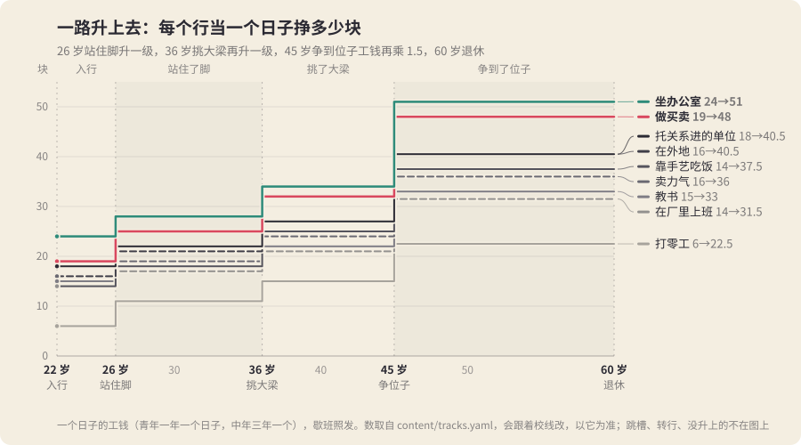

# 职业：入了行以后往上走的两级台阶

> 二十二岁定了干哪一行，往后十几年冲的是同一件事：在这一行里站住脚、挑大梁，四十五岁再争一个位子。

关口冲刺的成年段原来只有两头：22 岁「找个正经事由」定了一份工，一直干到 59 岁，中间只有 30 岁安家、45 岁争位子两道关，工钱从头到尾一个数。坐办公室的人从二十二岁到四十五岁每天过的日子一模一样，二十几岁那十年没有一道看本事的线可冲。

现在每一行都有两级台阶：

```
22 入行 ──→ 26 站住脚（rank1）──→ 36 挑大梁（rank2）──→ 45 争位子（mid_post，工钱 ×1.5）──→ 60 退休
```

升一级，**路的名字换了**（坐办公室 → 坐办公室 · 组长 → 坐办公室 · 科长），**一个日子的工钱涨一截**，30 岁安家、45 岁、70 岁那几道要钱的关跟着松。每道关前面，目标条上摆的是自己这一行的那条线。



## 一、怎么升

- 两道关在 `content/events/career.yaml`：`m_rise`（26 岁「站住脚」，青年）、`m_rise2`（36 岁「挑大梁」，中年）。第三级是原来 `milestones.yaml` 里 45 岁「四十五」的「去争那个位子」（心智魅力各半，线 74 分），打 `mid_post`。
- 关口只打标记：升一级打 `rank1`，再升打 `rank2`。行当的标记（`job_desk` 这些）不动。
- 每天去哪、几点收工、挣多少由 `content/tracks.yaml` 决定：每个行当前面多了 `<行当>_r2`、`<行当>_r1` 两条，`requires.flags` 比原来那条多一个 `rank2` / `rank1`。`lifeTrack` 从上往下取第一条符合的，所以有 `rank2` 的落在 `_r2`，只有 `rank1` 的落在 `_r1`。
- 45 岁争到位子的人工钱再乘 1.5（`rules.yaml` 的 `daily.wageFlags.mid_post`，乘在升过级的工钱上）。
- 岔口上换掉的路照旧排在前头：下了海（`job_own`）、下了岗支摊（`job_stall`）、没了事由（`job_lost`）的人不再走升过级的那条路，级的标记留着，可这一行已经不干了。

## 二、九个行当的阶梯

**表里的路名和工钱从 `content/tracks.yaml` 抄的，线和本钱从 `content/events/career.yaml` 抄的。这些数会跟着校线改，以那两个文件为准。** 线写成界面上看到的分（属性 × 10；yaml 里写 8.8，界面上是 88 分）。

### 路名和一个日子的工钱

| 行当（标记） | 22 岁入行 | 26 站住脚（`_r1`） | 36 挑大梁（`_r2`） | 45 争到位子（×1.5） |
| --- | --- | --- | --- | --- |
| 坐办公室（`job_desk`） | 坐办公室 24 | 组长 28 | 科长 34 | 51 |
| 托关系进的单位（`job_pull`，殷实） | 托关系进的单位 18 | 要紧科室 22 | 副手 27 | 40.5 |
| 教书（`job_teach`） | 教书 15 | 班主任 18 | 教研组长 22 | 33 |
| 做买卖（`job_trade`） | 做买卖 19 | 有了门脸 25 | 做批发 32 | 48 |
| 靠手艺吃饭（`job_craft`） | 靠手艺吃饭 14 | 出了师 18 | 开铺子带徒弟 25 | 37.5 |
| 卖力气（`job_labor`） | 卖力气 16 | 大工 19 | 拉一班人 24 | 36 |
| 在厂里上班（`job_succeed`，接班、安置） | 在厂里上班 14 | 技术员 17 | 车间主任 21 | 31.5 |
| 打零工（`job_odd`） | 打零工 6 | 有了长活 11 | 带几个人干 15 | 22.5 |
| 在外地（`left_city`） | 在外地工作 16 | 站住了脚 21 | 带一摊事 27 | 40.5 |

升了级的路有的还多长一点本事（科长多长魅力，教研组长心智魅力都长），出门的钟点和累不累跟原来那份工一样。

打零工原来那条是兜底（谁都能落进去），升了级的两条要 `job_odd`：只有 22 岁走了「打零工」那条路的人才升得上去。

### 每一级看什么

| 行当 | 26 站住脚 | 看什么 | 线 | 36 挑大梁 | 看什么 | 线 |
| --- | --- | --- | --- | --- | --- | --- |
| 坐办公室 | 评上组长，管一摊事 | 心智七成、魅力三成 | 92 | 当上科长 | 心智魅力各半 | 96 |
| 托关系 | 调进要紧的科室 | 魅力六成、心智四成 | 94 | 坐上副手的位子 | 魅力六成、心智四成 | 96 |
| 教书 | 当上班主任 | 心智魅力各半 | 81 | 当上教研组长 | 心智七成、魅力三成 | 86 |
| 做买卖 | 盘下一间门脸（30 块） | 魅力七成、运气三成 | 81 | 做起了批发（花 50 块） | 积蓄 | 90 块 |
| 手艺 | 出师，自己接活 | 体魄心智各半 | 83 | 收徒弟，开铺子（花 40 块） | 积蓄 | 70 块 |
| 卖力气 | 当上大工 | 体魄 | 76 | 自己拉一班人（花 30 块） | 积蓄 | 60 块 |
| 厂里 | 评上技术员 | 心智六成、体魄四成 | 69 | 当上车间主任 | 心智魅力各半 | 74 |
| 打零工 | 找着一份长活 | 体魄魅力各半 | 65 | 带着几个人干（花 20 块） | 积蓄 | 45 块 |
| 外地 | 在外地站住了脚 | 心智六成、魅力四成 | 90 | 在外地带一摊事 | 心智魅力各半 | 94 |

看本事的几行（坐办公室、托关系、教书、厂里、外地）36 岁另有一条「读个在职，评了上去」（`study`）：看积蓄，线 80 块、花 50 块，打 `rank2` + `studied`，和本行的 `top_*` 算同路。

**为什么 36 岁看积蓄**：`tools/sprint.mjs` 量出来，三十到三十六只有三十三岁那一个能过的日子，中年属性又长不动了，认真的人这一阶段纸带上只挪 0~3 分，看本事的线这一阶段几乎没人跨得过（开局就定了）。这两年挪得动的只有积蓄：三十岁买了房的人从零攒起，租房、住老屋的人手里本来就有。所以 36 岁是一道「三十岁那笔钱花在哪」的关：买房和挑大梁抢同一笔钱。

几条规矩：

- **第二级换一样看的东西。** 头一级多半看手上的本事（体魄、心智），第二级都要带上魅力：挑大梁是管人。二十几岁只顾埋头干的人，三十几岁要补人缘。
- **买卖和手艺的台阶要本钱。** 盘门脸、做批发、开铺子从积蓄里扣，扣在 30 岁安家那道 200 块的两头；36 岁这几行往上走看的就是积蓄。
- **工钱高的行当线也高。** 坐办公室、外地、托关系三行的线最高，打零工最低；天花板低的行当容易升，升上去也只到别人起步的数。
- **36 岁那关只给升过一级的人摆 `top_*`。** 26 岁没升上的，36 岁还有一回「熬了这些年，升了一级」（`late`，心智四成、魅力三成、体魄三成，线 88，打 `rank1`）。
- 两道关都有一条谁都走得了的兜底：26 岁「不争不抢，把手上的干好」（`steady`），36 岁「就这样，挺好」（`hold`）。一条路都走不通的人，服务器替他走兜底（`lifeMilestoneFallback`），不弹窗。
- **不同行当的人一起升也算同路。** 所有 `up_*` 都写 `joins: up_desk`，所有 `top_*` 都写 `joins: top_desk`：一个当上班主任、一个盘下门脸，算共鸣（「多买的汽水」「后回来的关灯」），长卷上两条线并成一条。

## 三、跳槽、转行

| 路 | 关 | 谁看得见 | 看什么 | 线 | 本钱 | 走了以后 |
| --- | --- | --- | --- | --- | --- | --- |
| 跟着老同事跳到别家（`jump`） | 26 | 没升过级的，打零工、进厂的除外 | 魅力六成、运气四成 | 80 | | `rank1` + `jumped`，行当不变 |
| 上夜大，考进机关（`to_desk`） | 26 | 不是坐办公室、托关系、外地的 | 心智 | 93 | 20 | 换成 `job_desk` + `switched` |
| 辞了，出来做买卖（`to_trade`） | 26 | 不是做买卖、外地的 | 魅力七成、运气三成 | 81 | 20 | 换成 `job_trade` + `switched` |
| 拜个师傅学手艺（`to_craft`） | 26 | 不是手艺、坐办公室、托关系、教书、做买卖、外地的 | 体魄心智各半 | 76 | | 换成 `job_craft` + `switched` |
| 被人挖去别家当个头（`poach`） | 36 | 升过一级的，打零工的除外 | 魅力七成、运气三成 | 89 | | `rank2` + `jumped`，亲近 −2 |

- **跳槽是同一行换个东家。** 看人缘和手气，不看本行的本事，所以本行的线够不着的人还有一条路往上走；代价是老同事那头断了（36 岁被挖走的，亲近掉一点）。
- **转行是从头干。** 转行的选项写 `effects.drop`，把八个行当的标记和 `rank1`、`rank2` 全摘掉，再打新行当和 `switched`：二十六岁升过级的人转了行，路名回到新行当的第一级，36 岁那关新行当的 `top_*` 不给他（没有 `rank1`），只能走「熬出来」。转行的线比 22 岁那天同一行的高一截，还要掏学费、本钱。
- `switched`、`jumped` 只是记一笔，给后面的事件、小结和结局读（现在还没有内容读它们）。

### effects.drop 的规矩（引擎）

- 关口和普通事件都能写：`effects: { drop: [job_desk, rank1], flags: [job_trade] }`。**先摘再打**，两边都写的标记留着。
- 普通事件挂了检定的，检定没成、换成了检定表 `fail.flags` 的不摘；成了、或者 `fail` 没写标记（用原来的标记）的照样摘（`server/src/sim.ts` → `lifeResolveEvent`）。
- build-content 校验：`drop` 必须是非空的字符串列表。

## 四、家境

守 `docs/MEANS.md` 的口径：家里能买路，不能替人长本事；每种活法下殷实比同活法的小康多够得着的不超过 15 个点。

- **26 岁殷实多一条「家里托人，调个好位置」**（`seat`）：心智魅力各半，线 88，花 25 块，打 `rank1` + `seat_pull`，算和本行升一级同路。线比坐办公室（92）、托关系（94）、外地（90）的本行升级低一截，比教书、手艺这些本来就低的行当高；钱从 30 岁安家那头出。它没写 `hide`：小康、清贫人家照旧看得见这条灰着，写着「家里没这层关系」，和中考那天的择校费一样。
- **36 岁殷实再多一条「家里再使使劲」**（`push`）：只给升过一级的殷实人家，线 92，花 40 块，打 `rank2` + `seat_pull`。它写了 `hide`：没升上的、不是殷实的都看不见。
- **清贫人家没有这两条**，也没有专门补的路：清贫人家常走的进厂（`job_succeed`，爸妈在厂里的吴家、佟家）、打零工，台阶的线本来就低（69 / 65），升上去工钱也低。
- 托关系进的单位（`job_pull`）只有殷实人家进得去，它自己的台阶照样要考，线和坐办公室差不多。

## 五、看得见的路：hide

一个人在 26 岁那关上摆出来的只有自己这一行的路，十几条别的行当的路不摆（灰着摆满一屏没意思，也看不出哪条是自己的）。

- **内容**：关口选项写 `hide: true`，必须同时带 `requires.flags` 或 `notFlags`（build-content 拦：hide 只能是 true，只能写在带标记条件的路上；普通事件的选项不收 hide）。一般也写 `lock`（「不是你这一行」）。
- **服务器**照旧：`lifeMilestoneLocks` 给每条走不了的路一个理由，标记不对的理由就是 `lock`（没写是「这条路不是给你留的」），够不着的写差几分、差多少块。服务器拦锁着的选择，影子不替人选，目标条（`lifeGoal`）本来就只摆标记对的路。
- **客户端**（`client/scripts/main.gd` → `milestone_options`）：写了 `hide`、**并且**锁着的理由正好是它的 `lock` 那句，才不摆。自己这行的路分数不够、本钱不够，理由是「心智和魅力 61 分，线是 88 分」「积蓄 3 块，要 30 块」，照旧灰着摆出来，让人知道差多少。
- **没写 hide 的路照旧灰着给人看**：接班、托关系、家里托人这些。家境的那几条要让人看见（MEANS 第二节），行当的路不用。
- **旧安装包**：客户端会从服务器下新内容（`content_get`），但旧的 `_show_milestone` 不认 `hide`，所有路都摆出来，别的行当的灰着写「不是你这一行」。能看、能选，就是一屏多一点。新安装包碰上旧服务器：内容里没有 `hide`，什么都不藏，和原来一样。

拿坐办公室、本事都够的小康人家看，26 岁那关摆出来五条：评上组长、跳槽、转行做买卖、家里托人（灰的）、不争不抢。各行当摆出来四到七条（`server/test/career.test.mjs` 打出来的数）。

## 六、怎么验

- `server/test/career.test.mjs`（`npm run server:test` 里，在 lives 后面）：
  - 九个行当（外地算一个）各有 `up_*` / `top_*`，`_r2`、`_r1` 排在原来那条前头、标记多一级、换了路名，工钱一级比一级高；
  - 26 岁每个行当别的 `up_*` 锁着、理由是 `lock`、客户端规矩下不摆、服务器拦、影子不选；自己这行的只因分数或积蓄锁；目标条只摆自己这行；
  - `up_desk` → `job_desk_r1`、`top_desk` → `job_desk_r2`、带 `mid_post` 再乘；
  - `to_trade` 摘掉 `job_desk`、`rank1`，带上 `job_trade`、`switched`，扣本钱；跳槽、挖人只加不摘；
  - 普通事件的 `drop`（手造的事件）：先摘再打、检定没成不摘；
  - build-content（拷一份脚本和 content 到临时目录跑）拦写坏的 `hide` 和 `drop`；
  - 兜底走 `steady` / `hold`；没有 `rank` 标记的老存档照旧走原来的路和工钱。
- `client/tests/unit_story.gd`：`milestone_options` 藏什么、不藏什么，安装包里写了 hide 的路都带 requires 和 lock。
- **线够不够冲**：`node tools/paths.mjs [每种活法几世]`（`UNTIL=37` 只过到挑大梁）：每种活法在 26、36 岁落在哪条线上，「不上心」的够不着、「专心」的大多够得着、殷实比同活法小康多不超过 15 个点。`node tools/sprint.mjs`：每道关「无可冲 ≤ 两成、跨过 ≥ 三成五」（career.yaml 文件头的口径是开局已过 ≤ 三成五、这一阶段跨过 ≥ 三成五）。`ORDER` 已经加了「站住脚」「挑大梁」。`node tools/career.mjs [每种活法几世]` 按行当打两道关的开局已过 / 跨过 / 没够着和升到的级；`node tools/career-means.mjs` 同一种子把两个人放进殷实、小康各过一遍到 37 岁，比升一级、升两级的比例。
- 收入曲线：`docs/img/career-income.svg` 是照「一路升上去」画的（26 升一级、36 升二级、45 争到位子），数改了要重画。

## 七、校出来的数（11-11）

- `node tools/sprint.mjs 8`，认真的人：站住脚 无可冲 0%、跨过 31%、失手 69%，阶段涨 2~7 分；随便的人跨过 19%。挑大梁 无可冲 13%、跨过 0%（见上面「为什么 36 岁看积蓄」）。
- 认真的人二十二岁考进办公室时心智多半已经 90 上下、顶到 100，升组长卡在魅力那三成：坐办公室的线原来 88 分，入行那天就过了，抬到 92。
- 家境：`tools/career-means.mjs 10`，七种活法殷实比小康升一级、升两级最多多 10 个点（口径 15）。
- 加了两道关以后 `legacy.test` 的「搭伴的连心七十岁并一家 ≤ 六成」量到 61%：升迁关的共鸣不再给亲近（只给默契），七十岁并一家的线 60 → 62。
- `story.test` 的「每种行当 40 岁都有人走上」改成按行当数（`<行当>_r1` / `_r2` 和原来那条算一个）：托关系进单位的六个人全升了级，原来那条没人走。

## 八、还没解决的

- 四十五那道关（争位子 74 分、花在家里 110 块）的阶段从三十六岁才开始，加上升了级工钱高，认真的人「无可冲」从 31% 到了 69%。线归玩法总把关，留给他们重摆。
- 回了城的（`came_back`）外地人，`job_away_r*` 不认，落到打零工，可他身上的 `rank1` / `rank2` 还在：打零工升了级的路要 `job_odd`，所以他拿的是最底下那一档 6 块。回城这件事要不要也写 `drop`，等写回城的事件时一起定。
- 下海、下岗以后的岔口路（`job_own`、`job_stall`、`job_lost`）没有台阶。升过级的人下了岗跟没升过的一样。
- paths 的机器人不看自己是哪一行，升级的比例被低估（「一个人念书」只有一成升得上去：心智顶满了，魅力那三成没练）。
