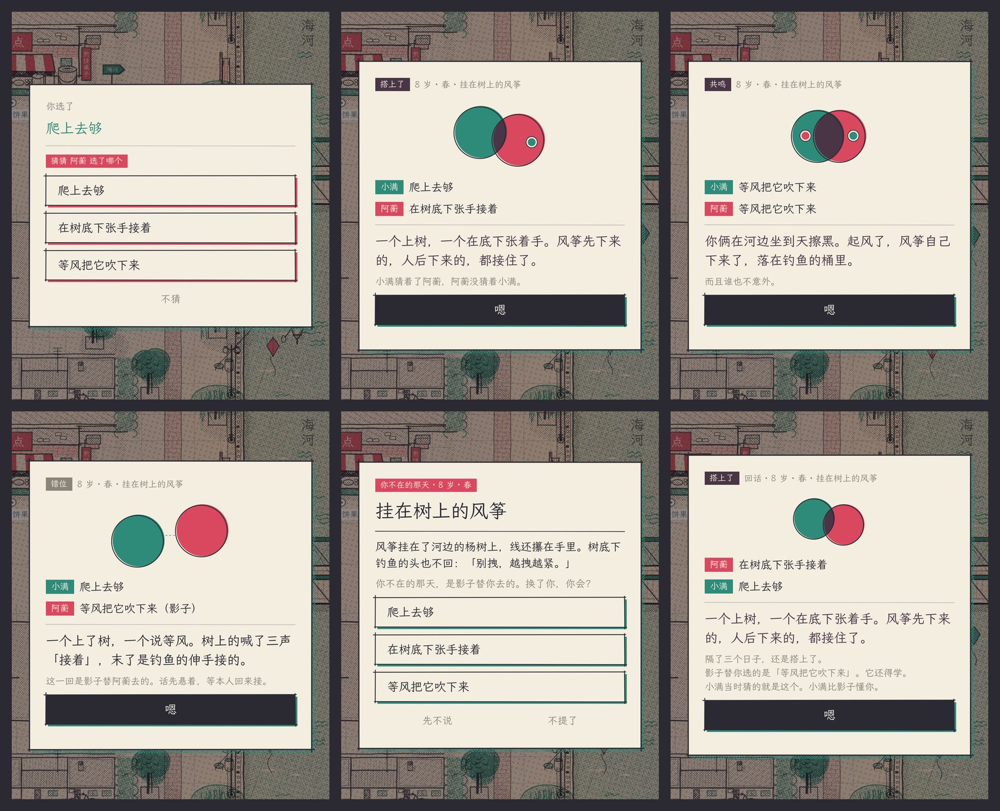

# 接话：两个人之间的玩法

> 默契不是选一样，是一个抛、一个接得住。

《同岁》的核心是两个人。原来的默契事件只有一种判法：两人不商量，选到同一项是「共鸣」，否则是「错位」。
这把「合得来」做成了「长得像」。可是真正处了一辈子的两个人，往往是一个上树、一个在底下张着手。

「接话」不加新系统，全部长在已有的默契事件上，原来改了三件事。

> **2026-11 重做 v0.4：猜 TA 砍掉了。** 一个默契事件里多点一下，节奏太碎，而且和「搭上了」争同一个注意力。服务器不再算猜测（CHOOSE 里带的 `guess` 直接忽略，协议不变），客户端不再问。老存档里的 `duet.know`、`owed[].guess` 照旧读得进来，不再增长。下面第二节留作记录。

| | 是什么 | 玩家多做了什么 | 得到什么 |
| --- | --- | --- | --- |
| **搭上了** | 选得不一样，但正好一个出招、一个接着，也算默契 | 什么也不用多做 | 第三种结算，自己的文案和回忆，计入默契率 |
| **猜 TA** | 选完自己的，再猜对门选了哪个 | 多点一下（可以不猜） | 「懂」，而且有方向：青懂梅，不等于梅懂青 |
| **回话** | 你不在时影子替你选过的事，回来后本人补答 | 回来时答一两道题（可以不提） | 可能把当年的错位补成默契；影子接着学你 |

三件事对应三个问题：**我们合不合**（搭上了）、**我懂不懂你**（猜 TA）、**你不在的时候怎么办**（回话）。



上排：猜 TA、搭上了、共鸣。下排：错位（对门不在，影子替选的）、对门回来后被问到、回话的结算。

## 一、搭上了

默契事件的选项按「逗 / 捧 / 独」来写：一个出招的，一个接着的，一个不接的。

```
风筝挂在了河边的杨树上。
  爬上去够            ← 出招
  在树底下张手接着      ← 接着
  等风把它吹下来        ← 不接
```

- 两人选一样：共鸣（照旧）。
- 一个「爬上去够」、一个「在树底下张手接着」：**搭上了**。「一个上树，一个在底下张着手。风筝先下来的，人后下来的，都接住了。」留下回忆「都接住了」。
- 其他组合：错位（照旧）。

规则上，搭上了和共鸣一样算默契（`entry.resonance = true`），计入默契率，会留回忆、可以打共同标记。
数值上它长的是**默契**而不是亲近（内容测试里有这条约束）：这是一种本事，不是一份感情。亲近照旧从共鸣、同框和各自的选择里来。

搭上了不需要改事件文件。它按事件 id 挂在 `content/duet.yaml` 的 `catches` 里，任何默契事件都可以挂，老事件也行（这一轮给「楼顶的夏夜」「河面的冰」各挂了一组）。

## 二、猜 TA（已砍，留作记录）

默契事件里选完自己的，多一步：「猜猜 TA 选了哪个？」可以不猜。猜测和选择一起发给服务器，对方看不到。

结算卡上多一句旁白，四种情况：

| | |
| --- | --- |
| 都猜中，选得一样 | 而且谁也不意外。 |
| 都猜中，选得不一样 | 没选到一块儿，可谁也没猜错谁。（亲近 +1） |
| 只有一个猜中 | 小满猜着了阿宁，阿宁没猜着小满。 |
| 都没猜中 | 你俩把对方都猜错了，也算扯平。 |

每猜中一回默契 +1。服务器分别记两个方向各猜中几回、猜过几回（`duet.know`），结局时多一句：「小满猜中阿宁 31 回，阿宁猜中小满 12 回。」

这句话是这个机制存在的理由。默契率是两个人共有的一个数；「谁更懂谁」是两个数，而且通常不相等。

结算卡上的两个圆（`client/scripts/ui/resonance.gd`，全游戏共用的那个标志）把这些画出来：共鸣是两个圆深深叠住，搭上了是斜着扣上一瓣，错位是擦肩而过；
猜中了，对方的圆里会落一个你的颜色的小点。两个人都猜中时，你中有我，我中有你。

## 三、回话

原来一方不在线时，影子按他攒下的性格标签替他选，选完就过去了。本人回来只能在日志里看到「（影子）」三个字。

现在影子替选的默契事件会先**欠着**（`duet.owed`）。本人回来时弹出来：

```
你不在的那天 · 8 岁 · 春
挂在树上的风筝
……
你不在的那天，是影子替你去的。换了你，你会？
```

盲答：不告诉你影子选了什么，也不告诉你对门选了什么。答完才揭晓：

- **当年是错位，本人的答案能接上**：补成共鸣或搭上了。「隔了三个日子，还是搭上了。」补一段回忆（记在当年，鲜明度低一级），长卷上当年那一笔改过来，计入默契率。两个人都会看到这张卡。
- **影子像不像**：「影子选的也是这个。它学得挺像。」或者「影子替你选的是『等风把它吹下来』。它还得学。」结局时多一句：「影子替阿宁去过 9 回，有 6 回选得跟本人一样。」
- **对门当年的猜测按本人的答案重算**：影子没选对、但对门猜的正是本人会选的，这一回补算猜中。「小满当时猜的就是这个。小满比影子懂你。」
- 本人的回答照样计入性格标签，影子下一回就更像你。

可以「先不说」（这一天不再问），可以「不提了」（放下这一句）。隔了 8 个日子没回的就接不上了；每人最多欠 6 句。
当年已经搭上或共鸣的不会因为回话被收回：那天确实接住了。

异步的双人游戏里，离线的那个人通常是被惩罚或被忽略的。回话把缺席变成一个可以回来接的话头。

## 五、关口上：拉一把、没拉上、重逢

> 2026-11 关口冲刺以后加的（`server/src/pull.ts`）。前四件都长在默契事件上；这一件长在关口上，因为一辈子最要紧的选择在那儿，「和 TA 一起过」也该在那儿算数。

关口冲刺（一个阶段一场冲刺：看线 → 押时间 → 看分数挪 → 开考揭晓）原来是两个人各冲各的：同框给成长倍率、默契在考场上托一点坏手气，到了选路那一刻，两个人只能各看各的锁。
可青梅竹马最常见的一幕是：一个够上了，一个差一点。

**拉一把**：一道关两个人都在、商量着选路（`各选各的，可以商量`）。

- 一个差几分没够上一条路，另一个够上了而且多出来的不少于差的：两个人都走这条，差的那个就跟着过去了。
- 看分的线最多拉几分看**默契**：默契在 5 以下拉 1 分，到 35 拉 4 分（两三个日子的力气，补不上一整个阶段）（`rules.bond.pullFrom / pullFull`，和考场托底用同一把默契的尺子）。默契从「省一点坏手气」变成「关口上能为对方做的事」，有了一个看得见的用处。
- 要钱的线（买房、退休出去走走、七十请人照应）是真把钱塞过去，最多塞多少看**亲近**：亲近到 60 塞得了 20 块（`pullMoney / pullMoneyClose`）。塞完自己还得走得了这条。默契是本事，亲近是情分，各管一样。
- 看亲近的线不拉：两个人是同一个数。不是给这户人家留的路（家里出钱的那条）也拉不进来。
- 差分的那个选了这条、对门却走了别的路：**没拉上**，按自己够得着的路里线最高的那条走，卡上写一句。两个人要商量，这一下是真押在对方身上。
- 影子不替被拉的人去赌；对门本人选了要你拉的路、你又走得了，你的影子会跟着走这条。

拉一把以后一个人的路就和另一个人的分绑在一起了：考前的那几天，搭伴不只是自己长得快，**是在给对门攒能匀的那几分**；挑路时，够得上更高的那条、却陪着走低一条去拉对门，是这个游戏想让人说出口的那种选择。

**重逢**：两个人都过的上一道关走散了（各走各的），这一道又走到一条路上：留一段回忆「又走到一块儿」，亲近、默契各添 2（`rules.bond.reunion`），卡上写「各走各的三年，到这儿又走到一条路上了」。

数（`node tools/playthrough.mjs`「认真」14 世，机器人会商量着拉）：两个人同过的关 127 道，拉得动的 12 道（一辈子一回上下，第一版 6 分 / 40 块时是 26 道，玩法总把关嫌大收了），六岁到七十岁都有；看分的差 1~3 分，钱差 3~16 块。重逢一辈子两回上下。

考前就看得见：顶上纸带差的那条写「阿蘅能拉你 3 分」，对门那头写「你能拉小满 3 分」，点开详情是整句（`pull.ts → pullGoalHint`，按两个人现在的数、不算手气，两个人下一关得是同一道）。拉一把因此是押时间时的一个决定：多陪对门搭伴几天，还是自己再冲一冲那 3 分。

界面：选路卡上，差分的那条不再灰着，写「差 3 分 · 和阿蘅一起走这条，TA 拉你过去」；对门那张卡上写「小满差 3 分 · 你也走这条，就能拉 TA 过去」；正文下面一句说为什么拉得动（默契几分 / 亲近几块）。
揭晓时自己的分先数完，对门颜色的那一截再接上去，接过线才盖印，旁边写「阿蘅拉了 3 分」（`ui/reveal.gd` 的 `pull`）。图在 `tools/shots/pull.gd`。

兼容：协议版本不变。EVENT 和快照里的 `event` 多一个可选的 `pulls`；旧安装包不认识它，差分的路照旧灰着（选不了，也就不会选错）。日志多一个可选的 `gate`（`pull` / `miss` / `reunion` / `lines`）。存档不动。

测试：`server/test/pull.test.mjs`（看分、看钱、没拉上、拉不动的几种、影子跟着、只剩一条自己的路时也要弹窗、重逢）；`client/tests/unit_pull.gd`。

## 内容怎么写

`content/duet.yaml`（改完 `npm run content`）：

```yaml
catches:
  d_kite_tree:                 # 事件 id，必须是 mirror 事件
    - pair: [climb, hold]      # 两个不同的选项，不分先后
      text: 一个上树，一个在底下张着手。风筝先下来的，人后下来的，都接住了。   # 48 字以内
      memory: 都接住了          # 8 字以内，一样握得住的东西
      bond: { sync: 3, close: 1 }   # sync 不小于 close
      flags: [p_xxx]           # 可选，共同标记
```

`lines` / `echo` / `epitaph` 是旁白，占位符见文件头。

写法上的要求：

- 文案只写动作和物件，不堆方言词。地方感来自东西（冰棍、棉袄、三级台阶），不来自语气词。
- 搭上了的文案写成一来一往，停在一个画面上，不下结论。
- 不是每个事件都要有搭上了。只有当两个选项真的是一抛一接时才写；硬凑的不如不写。
- 新写默契事件时可以按「逗 / 捧 / 独」三个选项来想（`content/events/duet.yaml` 里有 6 个例子），但不是必须。

## 实现

规则全在 `server/src/duet.ts`（纯函数），界面在 `client/scripts/duet/duet_ui.gd`（部件用 `ui/kit.gd`，两个圆是 `ui/resonance.gd` 加了第三种状态和猜中的点）。其余文件各改几行，方便和别的改动合并：

| 位置 | 改动 |
| --- | --- |
| `sim.ts` `lifeResolveEvent` | mirror 分支先问 `duetCatch()`，是搭上了就按搭上了结算 |
| `world.ts` `worldChoose` | 结算后调 `duetAfterEvent()`：算猜测，影子替选的记一笔 |
| `main.ts` | `CHOOSE` 多一个可选的 `guess`；新消息 `ECHO`（30）；快照里的 `life.duet` 走 `duetView()` |
| `save.ts` `lifeRepair` | 调 `duetRepair()`：剧情改了以后，欠着的话对不上就放下 |
| `tools/build-content.mjs` | 读 `duet.yaml`，挂到事件的 `catches` 和 `content.duet` 上 |
| `main.gd` | 六处调进 `duet_ui.gd`（见该文件头）；`_show_mirror_result` 保留为入口 |
| `tools/shots/shots.gd` | 截图脚本多出六张接话的卡（30 到 35） |
| `pull.ts` | 拉一把、没拉上、重逢（第五节）：`sim.ts` 结算前调 `pullResolve`、判完共鸣调 `pullReunion`，`world.ts` 的 `worldChoose` / `worldMilestone` 认 `pullOffer` |

状态：

- `LifeState.duet`：`know`（两个方向各 [猜中, 猜过]）、`like`（影子 [选得一样, 回过话]）、`owed`（欠着的话）、`epitaph`（结局多出来的几句，每次变化时重算）。
  可选字段，旧存档用到时自动补上，不需要升存档版本。
- `PendingEvent.guess`：当下的猜测，不进快照。
- 快照：`life.duet` 只走 `duetView()`（自己欠的话，不带「对门当年猜我会选什么」）；日志尾巴走 `duetLogView()`，我还欠着话的那几天先摘掉 `guess / knew / line`，回完话再给。
  对门当年**选了什么**仍在日志的 `choices` 里，盲答这一点只靠界面不显示：两个人合作的游戏，不值得为它改日志的形状。
- `LogEntry.duet`：结算附带的数据（`outcome` / `guess` / `knew` / `line` / `owed`；回话是 `echo: true` 加上 `lines` 等）。旧客户端不认识也不影响。

兼容：协议版本不变。老客户端不带 `guess`、不发 `ECHO`，一切照旧（只是看不到新卡片）；新客户端连老服务器，日志里没有 `duet` 字段，按 `resonance` 画。

测试：`server/test/duet.test.mjs`（内容约束、三种结算、猜测的四种旁白、回话的各种走向、存档修复、假 Nakama 里的完整联机流程）；
`client/tests/unit_duet.gd`（用真的主场景加一个假联机层，把每张卡走一遍）。

## 数值上的说明

新增的 6 个默契事件权重都是 2，搭上了的亲近只给 1：它长的是默契，不是亲近。
关系怎么涨、怎么淡由成长线管（`server/src/growth.ts` 的 `growthBond`，越高越难涨，见 [GROWTH.md](GROWTH.md)），接话这边加的每一点都走 `lifeApplyBond`，不绕过它。
测试里因此不比具体涨了多少，只和「同样的选择、但没猜 / 没接上」的对照比大小。

## 这一轮没做的

下面这些设计过、写过一版，这一轮为了聚焦核心玩法没有进主线。旧基底上的完整补丁留在项目文件 `tongsui/parked/duet-full-on-main.patch`。

- **一人一头**：需要两个人各站一头才能做的事（抬白菜、扯被单、搬煤）。等核心线程的「搭伴」定型后再看要不要做成它的一种。
- **一二三**：两个人不商量，同时出手的节拍小游戏。
- **等**：一个人先到约好的地方等另一个，等的时间本身变成回忆。
- **热乎劲儿和关系曲线**：把一生的亲近和默契画成两条线，标出每一次接住和没接住。
