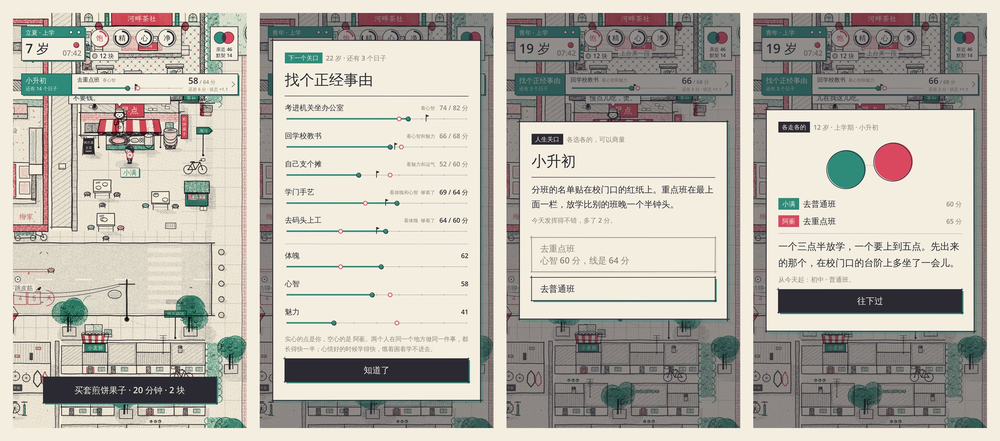

# 《同岁》游戏设计文档 v0.3

> 同一栋楼，同一年出生，同一生。

## 1. 定位

| 项 | 内容 |
| --- | --- |
| 品类 | 双人联机 · 人生模拟 RPG · 同框实时走动 |
| 平台 | Android（APK），后续可出 iOS / PC |
| 人数 | 2 人，固定搭档（一条"人生线"只属于两个人） |
| 一局 | 一生约 75 个"被记住的日子"，每个日子现实里约 4~6 分钟，可以分很多个晚上玩完 |
| 目标玩家 | 青梅竹马、发小、异地的朋友或情侣 |
| 情绪关键词 | 烟火气、怀旧、哏儿，偶尔有点疼 |

### 和同类游戏的区别

人生模拟 RPG 的乐趣是：**开局随机投胎**，然后过日子。吃饭、上学、睡觉，管好饥饿和疲劳，在城里各个地方遇到事，最后看自己活成了什么样。

《同岁》保留这套骨架，改了三件事：

1. **两个人同框**：两位玩家的角色在同一张地图上实时走动，看得见对方在干嘛。
2. **事件要两个人一起到场**：有些事只有你们俩同时出现在某个地方才会发生。
3. **人生会互相渗透**：一方的选择会改变另一方的属性、心情，甚至多年以后的事件。

## 2. 世界观：天津 · 河畔里

**河畔里**是天津市区里一片虚构的老楼。

- 一栋六层红砖楼，你们两家住**三楼对门**，中间是一条窄窄的楼道，冬天楼道里的暖气片总是烫手。
- **楼顶**：晾着床单，有人养鸽子，夏天晚上大家上来乘凉，能看到海河对岸的灯。
- **楼下**：一条老街，跳皮筋、拍画片的地方。街角是**早点铺**，煎饼果子、锅巴菜、豆浆。
- **自行车铺**：修车的爷爷，墙上挂着一把旧二胡。
- **海河边**：一座铁桥，春天放风筝，冬天河面冻上了可以推冰车。
- **小学**：走路十分钟。

城市会跟着你们一起变：童年时是红砖楼和自行车，少年时楼下开了网吧，青年时海河边建起了高楼，中年时这栋楼收到了拆迁通知。
时代做模糊处理：不写具体年份，不点名真实的店铺或品牌，用的都是天津人熟悉的东西（煎饼果子、冰嘎、相声、海河、楼道）。

两位玩家一个是 **「青」**，一个是 **「梅」**。这只是颜色和代号，性别、名字由玩家决定。
两人的关系**不预设**：可能是一辈子的发小、可能在一起、可能多年不联系又重逢。

## 3. 开局：投胎（抽家庭、天赋、属性）

两人都进入房间后，先**各自投胎**：

| 抽什么 | 说明 |
| --- | --- |
| **家庭** | 18 户河畔里的人家，各有家境（清贫 / 小康 / 殷实）、零花钱、属性加成和家庭标记。两户一定不同，因为你们是对门。每户人家有一条贯穿一生的专属剧情线 |
| **天赋** | 12 种先天天赋，大多数人是"普通的孩子"，少数人"过目不忘""倍儿哏儿""锦鲤""鸽子缘"……每种天赋都有专属事件，有回报也有代价 |
| **属性** | 体魄 / 心智 / 魅力 / 运气（0~10）。四项合计人人一样多，只是长的地方不一样；家庭和天赋的加成算在合计里面 |

- 每人有 **3 次重新投胎**的机会。
- 你能看到对门抽到了什么，TA 也能看到你的。（"你家是说相声的？那我天天来蹭。"）
- 两人都点"就这样，出生吧"，人生从三岁那年开始。

属性长一辈子：长多少看经历、年纪和底子，四十岁以后体魄往下走。有些选项成不成要看属性（检定），
两个人在默契事件里选到同一项，就按本事大的那个算（搭把手）。数值规则和模拟结果见 [GROWTH.md](GROWTH.md)。

### 十八户人家（`content/families.yaml`）

| 人家 | 家境 | 特点 |
| --- | --- | --- |
| 陈家 · 自行车铺 | 小康 | 体魄 +1，会修东西 |
| 林家 · 教书先生 | 小康 | 心智 +2，魅力 −1，家规严 |
| 周家 · 早点铺 | 小康 | 魅力 +1，整栋楼都认识你 |
| 许家 · 跑海运 | 殷实 | 运气 +1，父亲常年不在家 |
| 何家 · 姥姥带大 | 清贫 | 魅力 +1 运气 +1，一百个故事 |
| 苏家 · 裁缝铺 | 小康 | 魅力 +1 运气 +1 |
| 唐家 · 南方搬来的 | 殷实 | 心智 +1，魅力 −1，一开始没人跟你玩 |
| 吴家 · 钢厂双职工 | 清贫 | 体魄 +2，很早就学会自己热饭 |
| 顾家 · 说相声的 | 小康 | 魅力 +2，嘴皮子溜 |
| 江家 · 四口挤一间 | 清贫 | 运气 +2，什么都得抢 |
| 赵家 · 楼长家 | 小康 | 心智 +1 魅力 +1 运气 −1，腰上挂着全楼的钥匙 |
| 马家 · 楼顶鸽子棚 | 清贫 | 体魄 +1 运气 +1，三十多只鸽子都有名字 |
| 孟家 · 开出租的 | 小康 | 体魄 +1 魅力 +1 心智 −1，出租车后座是另一个家 |
| 刘家 · 楼下小卖部 | 小康 | 心智 +1 运气 +1 体魄 −1，全楼的孩子都想跟你好 |
| 白家 · 管红白事的 | 小康 | 心智 +1 魅力 +1，楼里谁家有事都请你爸张罗 |
| 金家 · 老城里搬来的 | 清贫 | 心智 +1 魅力 +1 体魄 −1，爷爷的规矩一样没丢 |
| 佟家 · 摔跤的 | 清贫 | 体魄 +2，倒了地的人不许再碰 |
| 傅家 · 扎风筝的 | 小康 | 心智 +1 运气 +1，一屋子竹篾和浆糊味儿 |

每户人家有 3 个左右的专属事件，从童年串到老年（`content/events/family.yaml`、`talent.yaml`，后加的四户在 `neighbors.yaml`），比如周家：凌晨三点帮爸妈和面 → 要不要接下早点铺 → 老了以后煎饼还是那个味儿。接下家里营生的人（`took_over`）会在结局里得到自己的一生小结。

### 十二种天赋（`content/talents.yaml`）

普通的孩子 / 过目不忘 / 天生神力 / 倍儿哏儿 / 锦鲤 / 夜猫子 / 小馋猫 / 鸽子缘 / 大嗓门 / 巧手 / 老好人 / 犟脾气。
天赋既改规则（过目不忘写作业翻倍、乐天派心情掉得慢、夜猫子晚上不困），也解锁专属事件：过目不忘的人忘不掉疼的事，老好人帮了所有人就是没帮自己。

## 4. 核心循环

> **两个人各有各的人生关口，却只有同一段时间可以花。**

这句话是整个游戏的核心玩法，别的系统都为它服务。它分三层：

| 层 | 多长 | 玩家在做什么 | 靠什么收尾 |
| --- | --- | --- | --- |
| 一天 | 现实 4~6 分钟 | 在河畔里自由走动，把时间分给三件事：自己长本事、过日子（吃睡洗）、陪对门 | 两人都睡了 |
| 一个阶段 | 几个到十几个日子 | 朝下一个**关口**攒分数。从三岁第一天起眼前就有一道关（上小学），到七十岁最后一道，中间不断档 | 关口那天，分数够哪条线就能走哪条路 |
| 一生 | 约 75 个日子 | 一关一关走出自己的路，和对门时而同路、时而分开 | 结局和人生长卷 |

取舍来自三处，缺一处这个游戏就只剩点选项：

1. **时间不够**。一天只有十五个半钟头，念书、锻炼、挣钱、玩、陪对门，做了这个就做不了那个。
2. **线有高低**。不上心的人够不着高线，专心的人大多够得着，一个人不可能所有的线都够着。
3. **两个人**。搭伴做同一件事两个人都长得快；可两个人要过的关、够得着的线不一样。够得着高线的人，可以为了对门走低的那条。

画面上常驻一条纸带，写着下一关是什么、还有几个日子、离最近的那条线差多少分、对门走到哪了（`client/scripts/ui/goal_panel.gd`）。



```
    ┌───────────────── 一个被记住的日子（实时，约 4~6 分钟）─────────────────┐
    │                                                                        │
 06:30 醒来 → 今天该去哪（上学/上班）→ 剩下的时间自己安排 → 属性一点点长       │
    │            │                                                           │
    │            └→ 走到对的地方 → 触发事件 → 私下选择 → 结算 → 回忆/关系      │
    │                                                                        │
 两人都睡了（或 22:00 撑不住）→ 一天结束 ──→ 时间跳到人生的下一个日子 ─────────┘
                                                   │
                              到了年纪 → 人生关口 → 按分数选路 → 换一条人生路线
```

### 4.1 被记住的日子 & 时间的密度

一生不可能每天都玩。所以《同岁》只让你过**被记住的日子**，中间的日子一笔带过。越长大，跳得越远：

| 阶段 | 年龄 | 每个日子之间隔 | 日子数 | 标签 |
| --- | --- | --- | --- | --- |
| 童年 | 3–12 | 一个季节 | 36 | 立春 / 立夏 / 立秋 / 立冬 |
| 少年 | 12–18 | 半年 | 12 | 上学期 / 下学期 |
| 青年 | 18–30 | 一年 | 12 | 某某岁 |
| 中年 | 30–60 | 三年 | 10 | 某某岁那几年 |
| 老年 | 60– | 五年 | 至死亡 | 某某岁那几年 |

童年的每一个季节都有名字，老年的五年只是一行字。玩家会在结局时意识到这件事。

### 4.2 一天之内：共享时钟

- 两人共用一个时钟：现实 1 秒 = 游戏 4 分钟，一天（06:30–22:00）大约 4 分钟。
- **两个人都在忙**（上学、睡觉、做长的事）时，时间 **快进 10 倍**。
- **有人在做选择时，时间停住**。
- 两个人都上床睡觉，一天立刻结束；22:00 还没睡，就"困得趴在桌上"，第二天精力差一些。

### 4.3 需求（生存）

| 需求 | 怎么掉 | 怎么补 |
| --- | --- | --- |
| 饱腹 | 每小时 −5（睡着 −2；小馋猫更快） | 回家吃饭、楼下买煎饼果子（花零花钱）、学校午饭 |
| 精力 | 醒着每小时 −4（夜猫子晚上不掉） | 睡觉 |
| 清洁 | 每小时 −2，玩耍、打工掉得多 | 洗澡 |
| 心情 | 上面任何一项太低都会掉 | 玩、吃好吃的、同框、好的事件 |

家境影响生活：殷实人家的饭让人更开心；清贫人家零花钱少，买套煎饼果子都得想想。
长期心情差会折寿。

### 4.4 能做的事（`content/map.yaml` → actions）

每件事只回答一个问题：它长什么。三项属性各有去处，想练什么一眼知道该去哪。

| 长什么 | 去哪 | 做什么 |
| --- | --- | --- |
| 心智 | 自己家的书桌 | 翻小人书（5 岁前）→ 写作业（6~17 岁）→ 看书（18 岁起）；河边跟大爷钓鱼也长一点 |
| 体魄 | 操场、海河边、楼下 | 踢球、放风筝（长大了是沿河走一圈）、跳皮筋；帮爷爷修车长得少一半，但能挣零花钱（拿成长换钱） |
| 魅力 | 茶社、楼下 | 喝茶听一段、上台来一段、跳皮筋、跟街坊聊会儿 |
| 心情 | 楼顶、早点铺 | 放鸽子、买套煎饼果子、下馆子 |
| 过日子 | 自己家 | 吃饭、睡觉、洗澡 |

同一个物件，不同年纪做不同的事（书桌、河边），所以地图不用跟着年龄换。
属性长多少还看状态：心情好学得快，饿着困着学不进去。所以玩不是浪费时间，玩够了再念书比闷头念一天划算。
成长的数值规则（年纪、底子、衰老）见 [GROWTH.md](GROWTH.md)。

### 4.5 人生关口（`content/events/milestones.yaml`）

| 年纪 | 关口 | 看什么 | 能走的路 |
| --- | --- | --- | --- |
| 6 | 上小学 | 各不相同 | 学习委员（心智）/ 体育委员（体魄）/ 文艺委员（魅力）/ 坐回座位 |
| 9 | 三年级 | 各不相同 | 数学小组（心智）/ 体校少年班（体魄）/ 少年宫曲艺队（魅力）/ 放学回家 |
| 12 | 小升初 | 心智 | 重点班 / 普通班 |
| 15 | 中考 | 心智 | 河对岸的市重点 / 家门口的高中 / 职校 |
| 18 | 高考 | 心智 | 外地的大学 / 本地的大学 / 直接上班 |
| 22 | 找个正经事由 | 各不相同 | 坐办公室（心智）/ 教书（心智和魅力）/ 支摊（魅力和运气）/ 学手艺（体魄和心智）/ 码头上工（体魄）/ 打零工 |
| 30 | 安家 | 积蓄 | 买房 / 租房 / 还住老楼 |
| 45 | 四十五 | 各不相同 | 争那个位子（心智和魅力）/ 把钱花在家里（积蓄）/ 把身体捡起来 |
| 60 | 退休 | 心智和魅力 | 带徒弟、接着干点事 / 歇着 |
| 70 | 七十 | 各不相同 | 两家并一家搭伙过（亲近）/ 每天自己下楼（体魄）/ 请人照应（积蓄）/ 坐在阳台上 |

每个阶段都以一道关收尾，前一关走的路接着后一关的日子，不另记分：

- **6 岁的小干部**还是同班，上学那一天多长一点对应的属性。
- **9 岁进的小组**是放学后（15:30~18:00）多出来的一个去处，只有进了的人做得了，比自己练快三成，小学毕业就散。两个人进同一个才能在那儿搭伴。
- **45 岁**三条路各接着 70 岁的一条：位子多挣五成工钱（接「请人照应」），花在家里的换来亲近（接「搭伙过」），捡起来的身体折成寿数（接「自己下楼」）。这是唯一一关两项属性都要够的线，偏科的人难，样样都练的人反而容易。
- **70 岁**是唯一看亲近的线：一辈子没断过走动的两个人才并得成一家，对门不在了这条路就没有了。走过的路折成寿数（每条 1~2 年，写在 `rules.yaml` 的 `lifespan.flags`）。

- 关口在到了年纪的那天清早到来。分数是平时一天天攒的，考场上只加一点发挥（±3 分上下，运气好的人略占便宜）。
- **默契托底**：对门还在的时候，手气差的那一半按默契折掉一些（默契 100 托住八成，最多两三分）。手气好不多给，属性也不动。这是默契在关口上的用处：它不让你更强，只让你在要紧的那天不那么容易失手。
- 积蓄和亲近的线按原数显示（「亲近 48 分，线是 55 分」），不算发挥。
- 分数按百分制给人看（属性 × 10）。够不着的路是灰的，写着「心智 60 分，线是 64 分」。
- 两个人都过这一关时各选各的，可以商量。选项上写着对门够不够得着。走了同一条路是「同路」，分开走是「各走各的」，各有文案、回忆和对亲近的影响。
- 成绩是事实，路是选择，两样分开记：考得上重点的人可以选普通班，后面的剧情认的是你走了哪条路。
- 只有一条路可走的人不用选，服务器直接替他定。

### 4.6 人生路线（`content/tracks.yaml`）

走上哪条路，决定了白天该去哪、去多久、长什么、挣多少。路线不存档，由身上的标记推出来。

| 例子 | 白天 | 代价和回报 |
| --- | --- | --- |
| 上小学 | 7:00~9:00 到校门口，上到 15:30 | 长心智，放学后还有半天 |
| 重点班 | 上到 17:00 | 心智长得快，自己的时间少一个半钟头 |
| 河对岸的市重点 | 6:30~8:00 过桥，上到 18:30 | 长得最快，回来天都黑了，和对门也远了 |
| 坐办公室 | 过桥上班到 18:00 | 挣得多，属性几乎不长 |
| 出摊 | 6:30 出摊到 14:00 | 挣得不少，下午是自己的 |

每天有三成的可能是休息日（关口那天除外）。日历牌上写着今天要去哪，地图上那个地方会有一圈波纹。迟到了就去不成，这一天的那份成长和工钱就没了。成年以后一个日子就是一年，歇班那天工钱照发：歇着的日子是留给两个人的，不该拿一年的收入去换。

## 5. 双人机制

### 5.1 搭伴

两个人**在同一个地方做同一件事**（一张桌上写作业、一起去踢球、一起上学），就是**搭伴**：

- 两个人这一次长的属性都乘 1.5。这是两个人一起玩的理由，也是每天要商量的事：今天陪你练你的，还是各练各的？
- 强的带弱的：对门这一项比你高，你的倍率再往上加（每高 1 点加 0.1，最多加 0.5）。
- 每种每天第一次搭伴，两人额外加心情和亲近，屏幕上飘一行专属文案："「俩鸡蛋，多放葱花！」你们异口同声。"
- 上学、上班也算，但要走的是同一条路（同一所学校、同一个行当）。
- 一天里搭过伴，亲近就不会淡（见 [GROWTH.md](GROWTH.md)）。

**搭伴的手感**：有的同框可以点进去一起动手。现在只有一处：两个人都在海河边放风筝时，问一句「一起放？」，两人都点了才开。
一个攥线管高低，一个牵着线跑管左右（每天换人），合力把风筝送进天上飘着的风口，三十秒。
它不是另一套玩法，也没有自己的奖励：放得好，只是这一回放风筝长的属性多一些（×1.5~2.0，最差也不比不玩差）；不玩、没理、对方不在线，都照常过。

### 5.2 默契时刻（地点事件）

- 每天开始时，"命运"会悄悄准备一件**默契事件**（mirror）和每人一件**各自的事**（solo）。
- 默契事件绑在一个地点和时间段上，比如"夏天傍晚的楼顶"。地图上那个地方会飘一行很淡的提示："楼顶好像有人在收凉席。"
- **你们俩都走到那里**，事件才会发生。没去，就错过了，这也是人生。
- 事件发生时两人各自私下选择，**看不到对方选了什么**：
  - 选到一起 → **共鸣**，生成一张共同回忆（"第四十七颗星"），默契 +。
  - 选得不一样，但正好一个出招、一个接着 → **搭上了**，也算默契，也留回忆（"都接住了"）。默契不是选一样，是一个抛、一个接得住。
  - 选得不一样 → **错位**，也有专属文案，也会被写进长卷。
- 选完自己的，还可以**猜 TA 选了哪个**。猜中是「懂」，而且有方向：结局会写"小满猜中阿宁 31 回，阿宁猜中小满 12 回"。
- 这三件事（搭上了、猜 TA、下面的回话）合起来叫「接话」，详见 [DUET.md](DUET.md)。

### 5.3 回忆会褪色

- 共同回忆有鲜明度（3 → 0），每过 8 个日子褪色一级。
- M2：人生低谷时（落榜、失业、亲人离世），另一方可以**唤起一段回忆**把对方拉起来。
- 褪色到 0 的回忆不会消失，在长卷上变成一道很淡的线。

### 5.4 影子

现实里两个人很难每次都同时在线。

- 一方离线时，他的角色由**影子**接管：按需求过日子（饿了吃饭、困了睡觉、上学日去上学），没事的时候偶尔会**去找在线的那个人搭伴**。影子替人过日子，不替人拼：日程一样不落，空下来的时间只有两成跟着对门、两成朝下一个关口使劲，不挣外快也不花钱。人不在的时候会落下一些（落在「不上心」和「一半念书一半玩」之间），但不会比本人在场还强。
- 遇到默契事件时，影子会"被叫过来"；30 秒内本人没回来，影子按他过去选择的**性格标签**替他选。
- 上线后能看到"你不在的时候……"的回顾。影子做的事在长卷上用虚线画。
- **回话**：影子替你选过的默契事件会先欠着，你回来后本人补答（盲答）。当年没接上、本人的答案能接上的，补成默契、补一段回忆；影子也接着学你。

### 5.5 距离与书信（M2）

- 少年和青年阶段，两人可能去不同的学校、不同的城市（北京、南方、国外），**地图会分开**，各自在自己的城市里过日子。
- 分开时不能同框，只能**写信 / 打电话**。信要过 1~3 个日子才到。
- 回到河畔里过年的那一天，是两张地图重新合在一起的一天。

### 5.6 独行与终点

- 寿命由出生时的命数、体魄、一辈子的心情和有没有人惦记决定，每一年都可能是最后一年。两个人很少在同一年离开；太亲的两个人，后走的那个往往撑不了太久。
- 先走的一方进入旁观：看着对方走完剩下的路，每个日子可以留一个很轻的"痕迹"（一只鸽子落在窗台上）。
- 两人都走完后，生成**人生长卷**。

## 6. 结局：双色人生长卷

### 6.1 多结局（`content/endings.yaml`）

人生走完时，按两个人一辈子留下的痕迹算出结局，写在长卷的最后：

- **两个人的结局**（14 种）：看共同标记（拉过钩、说出了那句话、结了婚、合伙开铺子、吵翻、重逢……）、亲近、默契、距离、共同回忆和默契率。从最难的「同岁」（结了婚、守住了小时候的约定、又足够默契）到「白头」「一张饭桌」「重逢」「合伙人」「还住对门」「那句话」「没回的信」「知己」「一辈子的发小」「远方」「走散」「点头之交」，兜底是「对门」。
- **每个人的一生**（29 种）：接下家里营生的人有专属小结（早点铺的手艺、说了一辈子、夜班车……），其次看属性、经历和寿命（冬泳的老人、读书人、桥下的琴声、远行的人、守着河畔里……），兜底是「普通的一生」。

### 6.2 故事线索

事件之间用**标记**串起来：童年在楼道墙上刻的名字（`p_wall_names`）会在拆迁那年被拍下来；海河边埋的铁皮盒子（`p_capsule`）会在老年被挖出来；少年时报了远处的学校（`school_far`），青年时就会有「回来的那个人」的故事。
共鸣（两人选到一起）和错位都可以给两个人同时打上**共同标记**（`p_` 开头），这是两个人一起做出的决定，会一直影响到结局。

### 6.3 长卷

一张可以保存、可以分享的长图：

- 横轴是时间（按日子，所以童年很长，老年很短）。
- 青的人生线用青色，梅的用梅红色；共同回忆处两色叠印成深墨色。
- 同框、书信、影子行为、错位时刻用不同笔触标在线上。
- 底部题词："你们一起过了 75 个被记住的日子，同框 136 次，留下 9 段共同回忆，默契率 64%。"

### 6.4 再来一世

长卷不是终点。一世走完，每个人按这辈子怎么过的给河畔里留下一件老物件（接了煎饼摊的留下竹刮板，教了一辈子书的留下半盒粉笔）；
两个人都点头，就在同一条人生线上重新投胎，各自可以从攒下的老物件里带一件走。
带上它只是开局多一点（先天属性最多半点、钱最多十块），不另起一套要攒的东西：没有点数，没有进度，这辈子怎么过还是这辈子的事。详见 [LEGACY.md](LEGACY.md)。

上一世还会在这一世里响一下：两个人在墙上刻过名字，下一世的两个孩子会在掉了皮的墙上看见它；埋过的盒子会被挖出来。
街坊会记住这两扇门里出过的事（吵翻过又和好、去了外地又回来），只是结局页上的一枚章、住户本里的一行，不给任何东西，没记住的也不显示。
有三种天赋要这条人生线上出过某件事才抽得到（复读过的人家出「大器晚成」），都是换一种活法，不是更强。
走完过一世就能翻「住户本」：每一世一页，谁生在哪家、活到多少岁、留下了什么。

## 7. 显影：用计算机视觉把现实写进游戏（亮点功能）

拍一张现实中的照片（你们俩现在的合影、小时候在海河边的老照片），在手机本地处理成游戏风格的回忆卡：

1. **XDoG** 提取墨线：两个尺度的高斯模糊相减，再用 tanh 软阈值，得到手绘感线稿。
2. **双色套印**：暗部墨色、中间调青或梅、高光留纸色，加套色错位和纸张颗粒。
3. 生成的卡片作为"现实回忆"插进人生长卷的当前位置。

全部在手机 GPU 上用 shader 完成（`client/shaders/xdog.gdshader`），照片不上传服务器。
进阶：端侧人像分割让两个人各上自己的颜色；FDoG 流场让线条更顺。

## 8. 美术方向

**孔版套色（Risograph）+ 墨线简笔**

- 画面是一张米白色的纸，所有东西都是黑墨线画的简笔画。
- 只有两种专色：**青 #2E8B7A**（也是海河的颜色）和 **梅 #D9485F**（也是红砖楼的颜色），外加墨 **#2B2A33** 和纸 **#F4EEE1**。
- 两人都碰过的东西两色叠印，出现孔版印刷特有的错位和颗粒。
- 字体推荐**霞鹜文楷**（OFL 开源，可商用）。
- 声音：自行车铃、鸽哨、早点铺的吆喝、收音机里的相声、海河的风。童年的声音密，老年的声音稀。
- 方言彩蛋：NPC 和部分文案带一点天津话（"介是嘛""倍儿哏儿"），不过度。

## 9. 内容规划

| 阶段 | M1 目标事件数 | 代表事件 |
| --- | --- | --- |
| 童年 | 40 | 楼顶的夏夜、暖气片后面的猫、除夕的二踢脚、冻上的海河、第一次打架 |
| 少年 | 30 | 课本上的纸条、分班、中考、楼下开了网吧、骑车去海边 |
| 青年 | 30 | 志愿填报、去外地、一封没回的信、婚礼 |
| 中年 | 20 | 拆迁、父母生病、孩子、重逢 |
| 老年 | 10 | 楼道墙上的名字、最后一封信 |

## 10. 出成绩

- **先做比赛和作品集**：童年篇（M1）就是一个完整的 30~60 分钟双人体验，适合投 CiGA Game Jam、IndiePlay 中国独立游戏大赛、腾讯 GWB 游戏创作大赛。"双人同框人生 RPG + 天津城市记忆 + 计算机视觉显影"是一个新鲜的组合。
- **地域文化**：天津老城记忆本身有传播力，可以联系本地文旅、高校比赛。
- **传播点**：人生长卷长图、显影回忆卡、"我们的默契率"、投胎截图（"我抽到了说相声的顾家"）。
- **商业化（可选）**：买断制（一对玩家一次付费）、DLC 城市（"如果我们在重庆的老巷子长大"）。不卖属性、不卖投胎次数。

## 11. 名字

《同岁》：同一年出生，也一起度过岁月。备选：《对门》（天津味儿更重）、《河畔里》。
