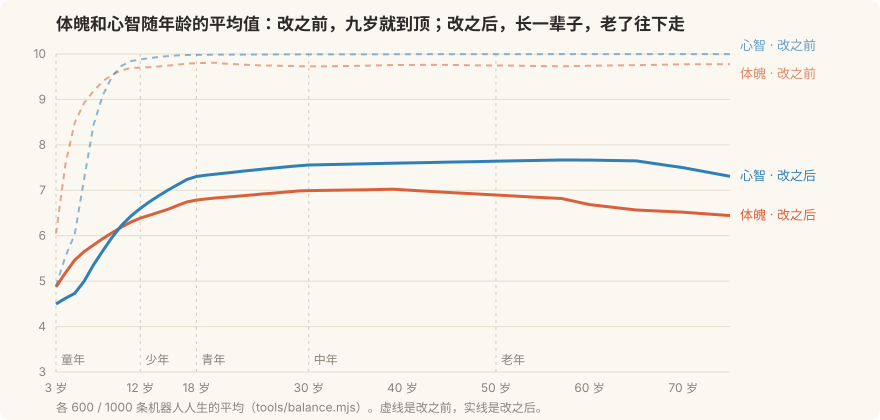

# 成长、数值与平衡

> 属性不是分数，是这个人。它应该长一辈子，老了往下走，并且每一点都在日子里用得上。

这份文档讲《同岁》的数值层：投胎、成长、衰老、检定、寿命、亲近。
数都在 [`content/rules.yaml`](../content/rules.yaml)，规则在 [`server/src/growth.ts`](../server/src/growth.ts)，
验证工具是 [`tools/balance.mjs`](../tools/balance.mjs)（`npm run balance`）。

玩法方向（《同岁》的核心是什么、节点和路线怎么走）由"重审核心玩法"的工作来定，这里只管数值的地基。
属性仍然是体魄、心智、魅力、运气四项，0 到 10。



---

## 1. 改之前的问题

先写了一个模拟器，让机器人按真实规则过完几百条人生（走地图、做行动、赴约、做选择），再看分布。原来的规则有五个问题：

| 问题 | 模拟结果（600 条人生） | 玩起来的感觉 |
| --- | --- | --- |
| **属性九岁就到顶** | 童年结束时心智平均 9.87，88.7% 的人顶到 9.5 以上；体魄 9.71 | 后面七十年的"+1 心智"全是空的，选项的属性回报没有意义 |
| **怎么活都一样** | 书虫、野孩子、宅在家的，到 30 岁各项都多长了 5 点上下 | 活法不留痕迹，重开一局属性还是那样 |
| **投胎不公平** | 四项合计 16 到 21；"普通的孩子"合计最低，锦鲤比它高 3 点 | 没抽到天赋就是亏，重抽只是为了刷数 |
| **寿命只有 6 种** | 只会在 70、75、80、85、90、95 岁走；17.8% 的两个人同一年走 | 生死像查表，"两个人不会同时离开"也没做到 |
| **亲近人人拉满** | 形影不离的和碰上才一起的都是 100，各过各的也有 94 | 亲近分不出两段关系的差别，14 种结局里有 3 种走不到 |

还有一条不在数里：**属性在日子里没有用**。它们只是结局的门槛，平时感觉不到自己体魄 8 和体魄 3 的区别。

## 2. 设计原则

1. **长多少 = 经历 × 年纪 × 底子。** 没有哪一项能靠刷刷满。出身决定从哪开始，活法决定走到哪。
2. **人人一样多，只是长的地方不一样。** 投胎决定的是形状，不是总量。
3. **每一点属性都用得上。** 体魄管累不累，魅力管在一起开不开心，运气管能不能碰上，四项都进检定。
4. **会老。** 四十岁以后体魄往下走，七十岁以后心智往下走，天天活动的人走得慢。
5. **亲近是走动出来的。** 越亲越难再涨，不见面就淡。
6. **数和规则分开。** 规则写在 `growth.ts`，数写在 `rules.yaml`，调数不用改代码，测试只管规则的形状。

## 3. 规则

### 3.1 投胎

四项先天属性的合计是固定的预算：**18 点**。清贫人家多 1 点，殷实人家少 1 点（钱和饭桌已经补上了）。
家庭和天赋的加成算在预算里面：过目不忘的心智 +2，是从别的地方匀过来的。

```
可随机分配的点数 = 预算 + 家境调整 − 4 × 下限 − 家庭加成 − 天赋加成
每项随机得到 1 到 7，再加上家庭和天赋的加成
```

"普通的孩子"原来是空白，现在有了自己的特点：什么都长得快两成。它是最常见的天赋，也应该是最耐玩的一种。

### 3.2 成长

```
实际长的 = 内容里写的数 × 来源系数 × 年纪系数 × 底子系数
```

| 因子 | 含义 | 现在的数 |
| --- | --- | --- |
| 来源系数 | 事件里的 +1 和日常行动里的 +0.3 不是一个量级 | 事件 0.15，行动 0.1 |
| 年纪系数 | 这个阶段这项属性长得多快 | 见下表 |
| 底子系数 | `1 − (现在 − 底子) / 5`，最少 0.06 | 一辈子最多比底子高 5 点，之后只能一点点蹭 |
| 底子 | `4.5 + (出生时 − 4.5) × 0.4` | 出身只算四成，其余按人人一样的平均数算 |

| 阶段 | 体魄 | 心智 | 魅力 | 运气 |
| --- | --- | --- | --- | --- |
| 童年 | 1.0 | 1.0 | 1.0 | 1.0 |
| 少年 | 1.3 | 1.3 | 1.1 | 1.0 |
| 青年 | 0.9 | 1.1 | 1.2 | 1.0 |
| 中年 | 0.5 | 0.9 | 0.9 | 1.0 |
| 老年 | 0.3 | 0.5 | 0.6 | 1.0 |

往下掉不打折：事件里的 −1 就是 −0.15，不看年纪和底子。

底子里出身只算四成（`bornWeight`）。出生时心智 7 的人底子是 5.5，起步就比底子高 1.5，上头的空间小；
出生时心智 2 的人底子是 3.5，起步比底子低，前面长得快。所以先天的差别在小时候最明显，越往后越看这些年怎么过的。

这一条是关口系统进来以后加的。原来底子就是出生时的属性，结果高考那一关上，出身好但不上心的人和出身一般但专心的人落在同一个分数段里，
分数线怎么划都分不开。出身算四成以后，外地大学那条线上，不上心的够得着的从 48% 降到 25%，专心的还是七成。

### 3.3 岁数不饶人

| 属性 | 从几岁起 | 每年掉 |
| --- | --- | --- |
| 体魄 | 40 / 60 / 75 | 0.03 / 0.06 / 0.09 |
| 心智 | 70 | 0.04 |

当天做过长体魄的事（去河边、巷子里玩、干活），体魄只掉四成；心智同理。
老了以后每个日子隔五年，所以"今天要不要下楼走走"在老年是真有分量的选择。

### 3.4 属性在日子里的用处

| 属性 | 用处 |
| --- | --- |
| 体魄 | 醒着时精力掉得慢（每高出 5 一点少 4%）；每高 1 点多活 1 年；体魄检定 |
| 心智 | 心智检定（高考再对一遍、楼下的棋局） |
| 魅力 | 同框时心情加成更多（两人合计每高出 10 一点多 4%）；魅力检定 |
| 运气 | 每天多一点遇上默契事件的机会（两人平均每高出 5 一点 +2%）；所有检定都沾一点 |

### 3.5 检定

有些选项成不成，要看本事。检定挂在已有事件的选项上（[`content/checks.yaml`](../content/checks.yaml)，现在 16 处），不改事件本身。

```
成功率 = 0.55 + (属性 − 难度) × 0.12 + (运气 − 5) × 0.03，夹在 8% 到 95% 之间
```

- 成了：选项原来的效果，加一句成了的话。
- 没成：不长属性，其余照旧，加一句没成的话。检定表里可以给没成单独写效果和标记（高考再对一遍没对出来，会打上 `gaokao_bad`）。
- **搭把手**：默契事件里两个人选了同一项，按两人里本事大的那个算，再加 1 点。体魄 2 的孩子自己跳不过那条河，对门那个体魄 8 的拉一把就过去了。

搭把手是这套数值里唯一直接奖励"两个人选到一起"的地方，它让属性差别变成两个人互相需要的理由，而不是谁比谁强。
检定的结果写在日志条目的 `checks` 里，客户端在结算卡上显示。

### 3.6 寿命

```
大限 = 出生时定的命数（76 ± 17，两头少中间多）
     + (现在的体魄 − 5) × 1
     + 一辈子的心气（平均心情比 85 每高 5 多活 1 年，−4 到 +2）
     + 有人惦记（亲近 ≥ 55 时 +2；人走了，惦记还在）
     − 撑不过那个冬天（对方先走，而且亲近 ≥ 85 时 −1.5）
夹在 56 到 104 之间
```

大限是每天重新算的：老了以后坚持活动，体魄掉得慢，大限就往后挪。
日子之间隔着好几年，人是在这几年中间的某一年走的，所以走的岁数按大限取整，不再是五年一档。
命数出生时就定了，但不给玩家看。

### 3.7 亲近

- **越亲越难再涨**：实际涨幅 = 写的数 × (1 − 亲近 / 100)，最少留 12%。默契同理。往下掉不打折。
- **不走动就淡**：一个日子过完，这天既没同框也没共鸣，亲近往下掉。童年 0.4，少年 0.9，青年 1.6，中年 2.4，老年 1.5（日子之间隔得越久掉得越多），离得越远掉得越多。
- 最多淡到 5：住过对门，总归认识。

## 4. 改之后的模拟结果

这一节是成长规则刚合并时的数（关口和日程还没进来）。关口系统合并以后的数见第 5 节。

1000 条人生（2000 个人）。机器人有五种活法（书虫、野孩子、小财迷、宅、随缘）和三种相处方式（形影不离、碰上就一起、各过各的）。

### 成长曲线（各阶段结束时的平均值）

| | 体魄 | 心智 | 魅力 | 运气 | 合计 | 心智顶到 9.5 以上 |
| --- | --- | --- | --- | --- | --- | --- |
| 出生 | 4.66 | 4.42 | 4.53 | 4.61 | 18.2 | 0.2% |
| 童年 | 6.34 | 6.50 | 5.27 | 4.67 | 22.8 | 6.0% |
| 少年 | 6.76 | 7.27 | 5.54 | 4.68 | 24.2 | 13.0% |
| 青年 | 6.99 | 7.54 | 5.75 | 4.69 | 25.0 | 16.3% |
| 中年 | 6.82 | 7.67 | 5.83 | 4.71 | 25.0 | 17.9% |
| 老年 | 6.08 | 7.41 | 5.84 | 4.71 | 24.0 | 14.8% |

改之前童年结束时合计已经是 32.4，之后只涨了 1.6。

### 前后对比

| | 改之前 | 改之后 |
| --- | --- | --- |
| 出生合计 | 16 到 21，标准差 1.14 | 17 到 19，标准差 0.55 |
| 童年结束时心智顶到 9.5 以上的人 | 88.7% | 6.0% |
| 到 30 岁，书虫比出生多长了 | 体魄 +5.1，心智 +5.4 | 体魄 +1.9，心智 +3.9 |
| 到 30 岁，野孩子比出生多长了 | 体魄 +5.5，心智 +5.5 | 体魄 +2.9，心智 +2.5 |
| 天赋之间 60 岁合计的极差 | 2.70（普通的孩子垫底） | 1.13（普通的孩子最高） |
| 寿命 | 平均 82.6，只有 6 种岁数 | 平均 78.6，标准差 7.3，43 种岁数，56 到 98 |
| 两个人同一年走 | 17.8% | 4.3% |
| 结束时的亲近：形影不离 / 碰上就一起 / 各过各的 | 100 / 100 / 94 | 86.5 / 53.5 / 17.3 |
| 走得到的结局 | 两个人 11/14，一生 24/25 | 14/14，25/25 |

### 结局分布（改之后）

知己 32.4%，重逢 18.3%，点头之交 11.8%，一辈子的发小 7.3%，还住对门 7.1%，对门 5.9%，合伙人 4.5%，远方 3.7%，没回的信 3.4%，走散 2.6%，那句话 2.1%，白头 0.5%，同岁 0.2%，一张饭桌 0.2%。

## 5. 关口系统合并以后

核心玩法加了人生关口（小升初、中考、高考、找工作、安家）和日程：到了年纪，分数够不够得着那条线，看这些年时间花在哪。
成长规则是它的地基，所以合并以后按关口的形状又调了一轮。验证用两个工具：`tools/paths.mjs`（九种活法过到 30 岁，看各条线的到达率）和 `npm run balance`。

调了六处：

| 改动 | 为什么 | 结果 |
| --- | --- | --- |
| 底子里出身只算四成（`growth.bornWeight: 0.4`） | 高考那关，出身好但不上心的和出身一般但专心的落在同一个分数段，线怎么划都分不开 | 见下表。顺带地，一辈子心智顶到 9.5 以上的人从 23% 降到 13% |
| 重点班的线 6.4 → 7.0 | 专心念书的人 98% 进重点班，一半一半的也有 88%，这一关几乎没有失手 | 专心一个人 89%，一半一半 75%，不上心 25%。中考的线没动，一半一半考上重点高中的 78%，没到八成 |
| 外地大学的线 8.0 → 8.3 | 不上心但上了高中的人里，有 48% 够得着 | 降到 24% |
| 工资按路线拉开，买房的线 140 → 150 | 各种活法买得起房的都是两成，钱和活法没关系 | 外地大学回来坐办公室的 57% 买得起，早早上工去摆摊的 66%，念了本市大学去教书的不到一成 |
| 做买卖的线 6.0 → 6.9、工钱 13 → 19 | 原来这条路线最低、钱也少，人缘好的人够得着教书就不会去摆摊，嘴甜这条活法买房的比例比什么都不练的还低 | 嘴甜的人里 59% 够得着做买卖；买房 30%，和混着来（31%）持平 |
| 亲近的整体系数 0.65 → 1 | 有了日程，两个人能凑到一起的时间少了，形影不离的也只有 57 | 形影不离 73，碰上就一起 47，各过各的 27 |

工资（每个出工日）：坐办公室 14 → 24，做买卖 11 → 19，卖力气 11 → 16，教书 10 → 15，手艺 10 → 14，先干着 8 → 12，在外地工作 18 → 16，打零工还是 6。
做买卖下午两点收摊，钱多是拿早起和风吹日晒换的；坐办公室要心智 8.2，是线最高的那条路。

### 各种活法够得着哪条线

每种活法 60 条人生（120 个人），关口上总选够得着的最高那条线；买房那一列另跑了 200 条人生（400 个人），因为几种活法挨得近，人少了分不出谁高谁低。
「之前」是核心玩法刚合并时的数。

| 活法 | 重点班（之前 → 现在） | 重点高中 | 外地大学 | 买得起房 |
| --- | --- | --- | --- | --- |
| 不上心 | 34% → 25% | 28% → 27% | 48% → 24% | 24% → 32% |
| 一个人念书 | 98% → 89% | 93% → 91% | 75% → 72% | 23% → 44% |
| 搭伴念书 | 100% → 100% | 100% → 100% | 71% → 90% | 20% → 48% |
| 一半念书一半玩 | 88% → 75% | 79% → 78% | 58% → 49% | 26% → 36% |
| 一个人练身体 | 33% → 23% | 28% → 25% | 48% → 19% | 28% → 33% |
| 搭伴练身体 | 24% | 28% | 19% | 39% |
| 嘴甜人缘好 | 36% → 23% | 30% → 27% | 45% → 23% | 22% → 30% |
| 各顾各的 | 55% | 58% | 53% | 36% |
| 混着来 | 61% → 47% | 53% → 50% | 52% → 33% | 23% → 31% |

外地大学那一列是参加了高考的人里的比例。搭伴念书从 71% 到 90%，是因为出身一般的那一半人现在追得上来了。
买房按活法看挨得很近（三成到五成），因为攒钱看的是走哪条路，不是怎么过：按路线看，外地大学回来坐办公室的 57%、早早上工去摆摊的 66%、早早上工学手艺的 38%，本市大学出来教书的 0～10%。

### 成长曲线和两个人（1200 条人生）

| | 体魄 | 心智 | 魅力 | 运气 | 合计 | 心智顶到 9.5 以上 |
| --- | --- | --- | --- | --- | --- | --- |
| 出生 | 4.65 | 4.52 | 4.52 | 4.57 | 18.3 | 0.2% |
| 童年 | 6.65 | 7.34 | 5.77 | 4.61 | 24.4 | 4.8% |
| 少年 | 7.12 | 7.99 | 6.20 | 4.61 | 25.9 | 9.5% |
| 青年 | 7.21 | 8.17 | 6.61 | 4.61 | 26.6 | 12.6% |
| 中年 | 6.92 | 8.25 | 6.81 | 4.63 | 26.6 | 14.2% |
| 老年 | 6.08 | 8.06 | 6.90 | 4.65 | 25.7 | 11.2% |

寿命平均 77.9 岁，42 种岁数，同一年走的 3.5%。结局 14/14 都走得到：知己 38.0%，重逢 13.6%，点头之交 12.7%，对门 6.6%，还住对门 5.8%，一辈子的发小 4.7%，那句话 4.3%，远方 4.0%，没回的信 3.1%，走散 2.3%，白头 2.3%，合伙人 1.9%，一张饭桌 0.5%，同岁 0.3%。每个人的一生 29/29 种都走得到。

上学以后心智比第 4 节高了不少（童年结束 6.5 → 7.3），因为上学是每天都去的日程。魅力有了茶社和街坊聊天两处来源，一辈子能长 2.3。

## 6. 还没解决的

- **专心念书的人中考还是很稳。** 重点班提线以后是 89%，重点高中 91%。中考的线要不要跟着提，等真人试玩看看一半一半的人卡在哪。
- **知己偏多（38%）。** 它的条件是默契率和回忆数，默契率普遍在 67% 上下，条件该收紧。
- **婚姻线的结局太稀有。** 白头、同岁、一张饭桌加起来不到 3%，比原来的不到 1% 好一些，还是少。
- **成年后歇班那天工钱照发（核心玩法线程后改的）。** 大约三成的日子是歇班日（`world.ts` 的 `REST_DAY_CHANCE`）。原来那天没有工钱，成年以后一个日子就是一年，八年里拿几年全看运气；现在十八岁以后歇班日一早照发，到手的就是表里写的数。买房的线随之从 150 抬到 200、租房从 60 抬到 100，上面表里买房那几列是改之前（线 150、歇班没工钱）的数，形状没变。小时候和少年不算，歇了就没有。机器人和影子都是准点到的，不存在迟到扣钱。真人会不会迟到、迟到一次心疼不心疼，要试玩才知道。
- **钱除了关口没有别的去处。** 平时几乎不花钱，攒多少只看挣多少。
- **心情还是太容易高。** 一辈子的平均心情在 84 到 95 之间，书虫例外（69）。
- **运气不会变。** 这是有意的（它是命），但也意味着锦鲤的 +3 一辈子都在，要不要让它付出点什么可以再想。

## 7. 怎么调数

```bash
npm run build                 # 重新生成内容并编译服务端
npm run balance               # 跑 1200 条人生，打印报告（不到一分钟）
npm run balance -- --lives 4000 --json out.json   # 多跑一些，把原始统计写出来
npm run balance -- --trace t_gaokao               # 看某个事件为什么碰不上
node tools/paths.mjs          # 十二种活法把人生过完，看每个关口各条线的到达率（约八分钟；UNTIL=31 只过到安家，约四分钟）
npm test                      # 规则的形状（谁该比谁多、什么不该发生）
```

改 `rules.yaml` 不用改代码。`tools/build-content.mjs` 会检查规则表的每一项都在，并且每一种家庭和天赋的组合都分得出点数。
测试（`server/test/growth.test.mjs`）不绑定具体的数，只在规则的形状变了、或者内容和规则对不上时才会挂
（比如把衰老调得太狠，让"冬泳的老人"这条小结再也走不到）。

读报告时先看这几行：

| 看什么 | 健康的样子 |
| --- | --- |
| 成长曲线"顶到 9.5 以上的人" | 童年结束时个位数，一辈子不超过两成 |
| 活法"到 30 岁比出生多长了" | 不同活法的强项至少差 1 点 |
| 天赋"60 岁合计的极差" | 1.5 以内 |
| 寿命"同一年走的" | 5% 上下 |
| 两个人"结束时的亲近" | 三种相处方式各差 30 左右，没有人顶到 100 |
| 结局"走到过" | 全部走得到，最常见的不超过四成 |

## 8. 一辈子之外

外圈的重玩价值叫「传承」，单独写在 [LEGACY.md](LEGACY.md)。和这份文档有关的只有两处：

- 老物件给的先天属性（一件最多半点）**算进出生的底子**（`Person.born`），所以第 3 节的「底子」和「上头的空间」照旧成立：带着它不会长得更快，也不会更慢。
- 它压不过活法：同一批种子，带着一箱书的不上心的人，进重点班只比空着手多 6 个点，离一半念书一半玩的人还差 48 个点。数在 LEGACY.md 第三节，断言在 `server/test/legacy.test.mjs`。

记活法的那些事（成就）、藏着的天赋和结局是传承的第二步，方向已经收过：只是长卷上的一行，没有奖励；天赋跟着具体的事走，是另一种活法，不是更强的活法。
