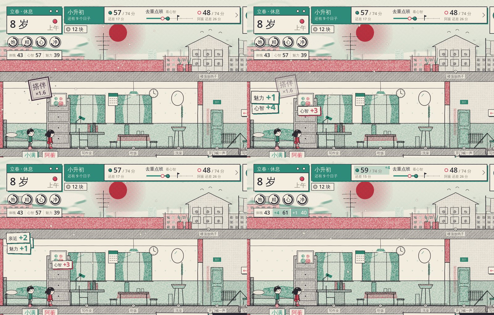
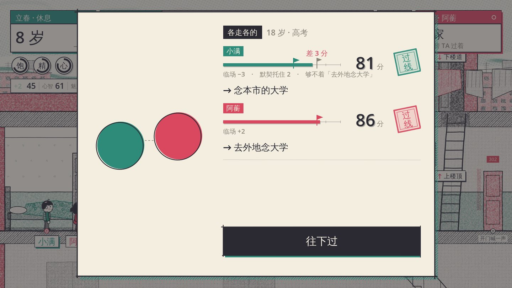
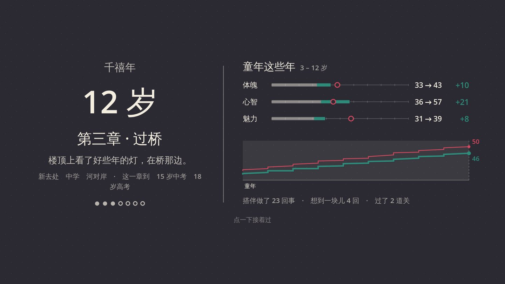

# 爽感层：每一件做完的事都有个响儿

核心循环是「看线 → 押时间 → 当场看分数挪动 → 开考揭晓 → 换路」。这一层管第三、四拍的手感：
分数挪动要**看得见、听得见、落得下**，揭晓要**有悬念、有结果、有余味**。规则一行不改，全是表现。

## 四样东西

| 时刻 | 看到的 | 听到的 | 代码 |
| --- | --- | --- | --- |
| 开始做一件事 | 脚下一圈自己颜色的墨晕开 | 行动原有的声音 | `ui/juice.gd` `_ring` |
| 做完一件事 | 搭伴的先在两个人中间砸一方「搭伴 ×1.6」的印；长的分、挣的钱、亲近一张一张从人头上印出来，停一下，沿弧线飞进 HUD：三项飞进成长账那一格、钱飞进零花钱、亲近和默契飞进两个圆（两个圆挤一下）。落下的那一刻格子里的数才拨上去，关口纸带上的「还差几分」也同时拨、挂一个「+4」。TA 长的分在 TA 头上小一号冒一下 | 盖大印；每落一张「嗒」一声木琴，连着的按五声音阶一个比一个高；钱是钢镚儿 | `ui/juice.gd`、`ui/stat_strip.gd`、`ui/goal_panel.gd` |
| 关口揭晓 | 两个人的分同时从 20 往上数，尺子跟着长；数过线的那一下小旗翻成自己的颜色；数完了够着的盖一方印（有成绩档印成绩档），差一点的停在灰旗前面，旗子抖两下，写「差 3 分」，底下一行「临场 −3 · 默契托住 2 · 够不着『去外地念大学』」；都数完了卡片震一下，再露出各自走的路和这一关的那句话 | 算盘珠子一颗一颗拨上去（越往上音越高）；过线一串八音盒 5 6 1 3；差一点是两声往下走的软木头 | `ui/reveal.gd`、`main.gd` `_show_milestone_result` |
| 一个阶段过完 | 长大的那张墨卡右边多一张成绩单：这一阶段三项从多少长到多少（灰的是带进来的，彩色是这几年长的，空心圈是 TA 现在在哪），一路过来的长势曲线（实线是我、细线是 TA，竖线隔开阶段），搭伴做了几回事、想到一块儿几回、过了几道关。点一下揭开 | 翻一页，八音盒 1 2 3 5 6 1 | `ui/stage_report.gd`、`ui/fx.gd` `report_hook` |

HUD 左边四个圆表底下多了一条「成长账」：体魄 / 心智 / 魅力，百分制。点开是正在过的这一阶段的成绩单（纸上版）。

## 数从哪来

- **一律用服务器给的数的差**：WORLD 里 `stats / money / bond` 前后两帧比，属性按 `floor(x × 10)`，和关口纸带（`lifeGoal`）、关口分数（`lifePoints`）一个口径。不到 1 分不飘。
- 服务器在 `actors[role].did` 里说了「刚做完哪一件」（`n` 递增，见「一天行动循环」的 PR）时，拿它认搭伴 `tg` 和倍率 `b`，并且等 `DID_LEAD`（0.95 秒，那边的钟从 f 拨到 t）再飘；没有 `did` 的服务器照样飘，按上一帧在不在搭伴认。
- 开着弹窗、过场卡、当天小结（`main.day_card`）的时候**不飘也不补**：那些数在弹窗里另有交代。
- 关口揭晓要的几样由服务器给（`sim.ts` → `lifeReveal`，`results[role]` 上的可选字段，旧安装包不认也不碍事，不升协议）：
  - `line` 走的这条路的线；`luck` 这一场的临场发挥（已经算在 score 里）、`steady` 其中默契托住的那截，百分制；看原数的线（积蓄、亲近）没有这两项
  - `miss { option, need, have }` 标记对得上、只差分数的路里离得最近的那条
- 成长账存在客户端 `user://growth/<人生线>.json`，一个日子一个点 `[turn, age, stage, 我三项, TA 三项]`，外加每个阶段的搭伴 / 想到一块儿 / 关口计数。换了一世（回合往回走）从头记。换了手机就从换的那天记起，成绩单只讲记得的那一段。

## 声音

六个新音效，`tools/audio/tongsui_audio/sfx.py` 合成（`python3 tools/audio/build_audio.py sfx --only gain,bead,seal,pass,miss,settle`），材料还是纸、木头、印泥，加一样算盘：

`gain` 木琴 + 八音盒（引擎里按五声音阶调 pitch）· `bead` 算盘珠 · `seal` 盖大印 · `pass` 印 + 八音盒往上一串 · `miss` 两声软木头往下 · `settle` 翻页 + 八音盒慢慢往上。音量在 `audio_director.gd` 的 `CUE_DB`。**没有人用耳朵听过**，音量多半要按听感调。

## 怎么看

- 单测：`client/tests/unit_juice.gd`（CI 的 `tools/ci/client_unit.sh` 自动跑）
- 截图：`godot --path client --rendering-driver opengl3 --resolution 1920x1080 --script res://../tools/shots/juice.gd -- --out=<目录>`
- 录屏（带声音）：同上再加 `--write-movie x.avi --fixed-fps 30`，参数里加 `--movie`

## 以后

- 「一天行动循环」的 `did.j`（对门后赶上、给你补的搭伴那一份）现在和普通搭伴一样盖印，可以单独写「TA 来了」。
- 需求（饱、精、心、净）不飘字，圆表自己会追；吃完饭心情一下子满了，可以让圆表闪一下。
- 真机上没看过：飘字在 20:9 长屏、刘海边上的位置；`Tag` 一次最多五张。
