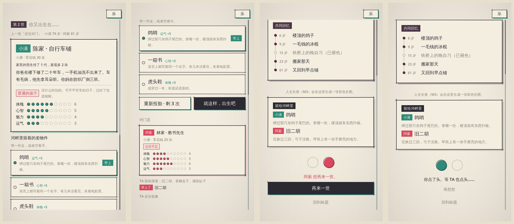
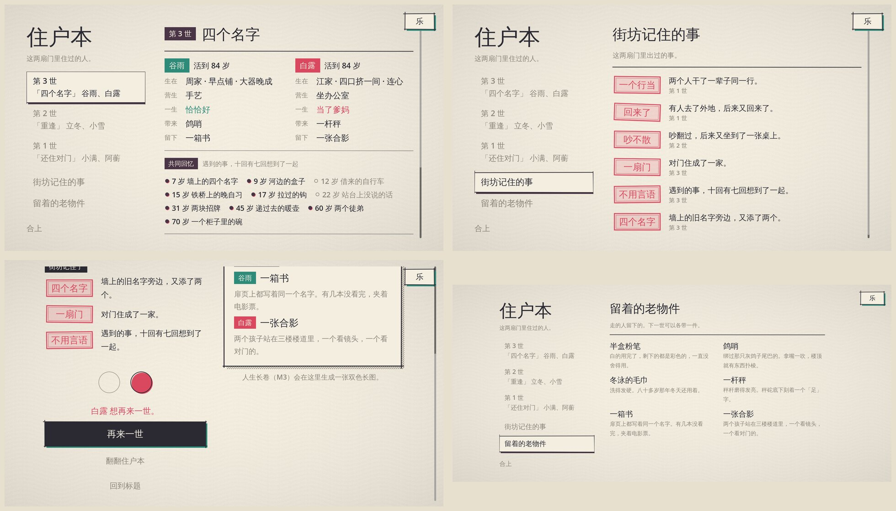
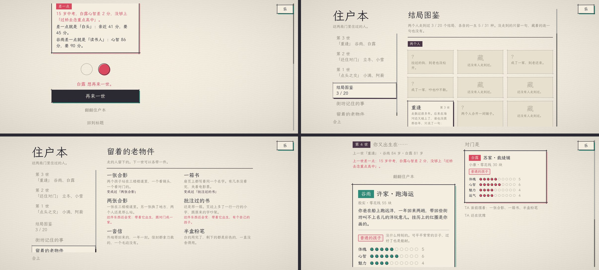

# 传承：一辈子之外

> 人走了，东西还在楼里。

一条人生线走到结局就停了。可两个人一起过完一辈子以后，最想做的事是「再来一回，这次换个活法」。
传承只做这一件事：把「再来」接上，并且让上一世在下一世里留一点痕迹。

它是外圈，不是另一套要攒的东西。核心玩法还是那三样：时间花在哪、关口走哪条路、和对门搭不搭伴。
所以这里守着几条线（方向由核心玩法那边定，见 [GDD.md](GDD.md)）：

- **没有点数、进度条、解锁树。** 跨世留下来的只有具体的东西：一件老物件、一行小传、一户人家传了几代。
  （第十三节起改了一半：结局图鉴和没记住的事摆出来给人看、写着攒到了多少，这是为了让人想再来一世；可它们照旧不换任何数值。）
- **一世最多带一件，带过的不会越带越强。** 同一件东西第 2 世带和第 10 世带，多出来的一样多。
- **老物件给的是开局，不是结果。** 先天属性最多半点；从上一世带来的钱，老物件和家业加起来最多十块。它能让一条够不着的线变得够得着一点，替不了这辈子怎么过。
- **两个人的事两个人看得见。** 对门面前摆着什么、带上了哪件，我都看得见；再来一世要两个人都点头。



横屏（20:9）。上排：第二世的投胎页，我的出生证在左、对门的和 TA 带上的那件在右；往下是我面前并排摆着的三件老物件。下排：结局页，「留给河畔里」跟共同回忆在右栏，再来一世在左栏，对门先点了头；我点了以后等 TA。

分两步做的。第一步把循环闭上（一到六节）；第二步往循环里放东西：痕迹和隔世的事、街坊记住的事、藏着的天赋和结局、住户本（七节以后）。

## 一、一世走完：留下一件

结局算出来以后（`lifeEndDay` → `legacyAbsorb`），每个人按这辈子怎么过的，给河畔里留下一件老物件。
规则和一生小结一样：`content/heirlooms.yaml` 里从上往下，取第一件对得上的；最后一件没有条件，兜底。

| 怎么过的 | 留下 | 带上它 |
| --- | --- | --- |
| 接了家里的煎饼摊 / 相声 / 车铺 / 楼长，或别的营生 | 竹刮板 / 折扇 / 老扳手 / 一串钥匙 / 老账本 | 魅力、体魄或心智 +5 |
| 拉了一辈子二胡 | 旧二胡 | 魅力 +5，这一世的孩子从小摸得着琴 |
| 心智到了 9 | 一箱书 | 心智 +5 |
| 体魄 7 以上、活过 84 | 冬泳的毛巾 | 体魄 +5 |
| 一行干到退休（教书 / 买卖 / 手艺 / 码头 / 机关） | 半盒粉笔 / 一杆秤 / 帆布工具包 / 垫肩 / 搪瓷缸子 | 那一行用得上的属性 +5 |
| 两个人结了婚 | 喜糖盒子 | 亲近 +6 |
| 两个人养过鸽子 / 埋过东西 | 鸽哨 / 铁皮盒子 | 运气 +5 |
| 去了外地 | 一沓信 | 心智 +5 |
| 有了孩子 | 虎头鞋 | 体魄 +5 |
| 走的时候兜里有 130 块 | 存折 | 零花钱 +6 块 |
| 以上都不是 | 一张合影 | 亲近 +3 |

（属性按界面上的百分制写：+5 就是规则里的 0.5 点。）

留下什么由活法决定，不由属性高低决定：表里靠属性的只有两件，其余都是「做过什么」。
每件东西的文字只写物件本身，不写它代表什么。

**两个人不留同一件。** 先走的先留，后走的那个接着往下找（都只剩合影的时候除外）。
所以一个人自己挣来的排在前面，两个人一起做过的排在后面：不然一起养过鸽子的两个人，回回都只留下一只鸽哨，下一世面前也只有那一件。

同时记下的还有（都在 `LifeState.legacy` 里）：

- **小传**：这一世的结局、两个人各自的一生小结、活到几岁、干的哪一行、记得最清的四段共同回忆的标题。只留最近 6 世。
- **住过的人家**：每户人家住过几回，其中几回接下了家里的营生。

结局页多一栏「留给河畔里」，写着两个人各留下了什么。

## 二、再来一世

结局页最下面是「再来一世」。一个人点了，对门那边立刻看得见（两个圆里他的那个印上了颜色）；可以收回。
两个人都点了，就在**同一条人生线**上重新投胎：还是这两个人，还是青和梅，配对码不用再输。

- 票记在存档里（`LifeState.again`），点一下存一次。一个人先点了下线，隔天另一个人上来点，照样算数。
- 换世是纯函数（`legacyRebirth`）：新一世的种子接着存档里的随机数走，同一份存档换出来的下一世是同一个。
- 换世前先把走完的这一世**归档**（见第五节），存档里只带走传承，不带长卷。

## 三、投胎：各带一件

第二世起，投胎页多三样东西：

1. **页头**：「第 N 世」，和上一世的一行小传。
2. **家业**：抽到的人家如果之前有人接下过营生，出生证上多一行「家里的营生传了 N 代，家底多 M 块」。一代 2 块，两代封顶。
3. **老物件**：攒下的东西洗开，两个人面前各摆最多三件，不重样。点一件带上，再点一下放下，确认投胎之前都能换；也可以空着手。

东西是单数的时候总有一个人多一件，谁先摆一世一换。重抽人家不动面前摆的东西。

带上的那件在出生时生效（`lifeConfirm` → `legacyBirth`）：

- 属性加在先天属性上，**也算进出生的底子**（`Person.born`）。成长规则按底子算上头的空间（[GROWTH.md](GROWTH.md) 第 3 节），所以这半点不会让他往后长得更慢，也不会更快。
- 钱加在开局的零花钱上，亲近加在两个人开局的亲近上。
- 标记（`heir_xxx`）出生就带着，事件可以读到。旧二胡多给一个 `erhu`：家里挂着一把现成的。

### 它压不压得过活法

这是最要紧的一条：半点属性如果能顶替「这辈子怎么过」，前面的取舍就白做了。
用 `tools/paths.mjs` 的机器人各跑 200 个人，同一批种子，一组空着手，一组两个人都带着一箱书（心智 +5）：

| 活法 | 12 岁心智 空手 → 带书 | 进重点班 空手 → 带书 |
| --- | --- | --- |
| 不上心 | 58 → 62 分 | 22% → 28% |
| 一半念书一半玩 | 77 → 80 分 | 76% → 83% |
| 一个人念书 | 84 → 87 分 | 91% → 97% |

带着书的不上心（28%）离空着手的一半一半（76%）还差得远；专心念书的空手人比带书的不上心多 22 分心智。
老物件挪的是几个点，活法挪的是几十个点。这几条钉在 `server/test/legacy.test.mjs` 里，和 `paths.test.mjs` 的几条用的是同一套机器人。

同一件东西在别的线上挪得多一些：什么都练一点的人（混着来），考进机关那条线原本 32% 够得着，带着书是 47%；
专心念书的空手人是 85%，不上心的是 16%，次序没有变。半点已经是上限，再多就该换次序了。

钱要单独看。买房那条线（200 块）很陡，线附近的人多，几块钱就能挪好几个点。每种活法 200 个人，30 岁够得着买房的比例：

| 活法 | 空着手 | 带着存折（+6 块） | 存折加两代家业（+10 块，上限） |
| --- | --- | --- | --- |
| 不上心 | 24% | 29% | 31% |
| 混着来 | 26% | 33% | 35% |
| 嘴甜人缘好 | 32% | 37% | 39% |
| 一个人念书 | 44% | 52% | 53% |

带满了的不上心（31%）够不着空着手念书的（44%），更够不着从小挣钱的（73%）；但它比属性那半点挪得多，是这套东西里最接近上限的一处。
所以钱收得比属性紧：存折 6 块，家业一代 2 块、两代封顶，加起来最多十块，`npm run content` 会拦住超过的。
如果真人试玩觉得「上一世攒的钱」味道不对，把这两个数改成 0 就行，别的不受影响。

## 四、两端怎么对上

- 协议版本 2 → 3。`MIN_CLIENT_PROTOCOL` 和 `MIN_SERVER` 不动：旧安装包照样进得来，照样能过完一辈子，只是没有「再来一世」。
- **房间知道两边安装包的版本。** 3 版的客户端进房时在 `join_match` 的 metadata 里报 `protocol`，没报的按能进来的最旧版本算。
  快照和 `PRESENCE` 里都带 `protocols: {qing, mei}`（不在线是 0）。这是连接上的事，记在房间里，不进存档。
- 新安装包看见对门的版本不到 3，「再来一世」按不下去，写明「TA 的安装包还是旧的」。
- `31 AGAIN` 只发给版本够的连接；旧安装包收到的仍然只有它认识的消息号。换世以后发的是 `SNAPSHOT`，旧安装包也跟着到投胎页（它看不见老物件，等于空着手）。
- 新安装包连着旧服务器：`lifeline_open` 回复里的协议不到 3 就不画按钮，不靠点了以后报错。

| 消息 | 变化 |
| --- | --- |
| `2 ROLL` c→s | 多一种 `{heirloom: id \| null}`：挑一件带上 / 放下 |
| `3 ROLL_STATE` s→c | `rolls[r]` 多了 `house`、`offer`、`heirloomId`，两个人的都发 |
| `1 SNAPSHOT` s→c | 多了 `protocols`；`life` 里多了 `life`、`legacy`、`left`、`again` |
| `11 PRESENCE` s→c | 多了 `protocols` |
| `31 AGAIN` 双向 | c→s `{yes}`；s→c `{again: {qing, mei}}` |

## 五、存档

- 存档版本 5 → 6（`save.ts`）。旧存档当作头一世：`legacy` 是空的，抽卡和人身上补上空的老物件栏。
  有传承之前就走完的那一世，房间拉起时补记一回（`legacyRepair`），所以老的结局页也能点再来一世。
- **走完的一世单独归档。** 换世时把整份 `LifeState`（去掉 `legacy`、`again` 和随机数）写到另一个存储对象
  `lifeline_past/<人生线 id>.<第几世>`，然后才把存档换成新的一世。存档里跨世带着的只有 `legacy`，大小有界（连过 8 世约 2.5 KB）。
  长卷不会一世一世地摞在存档里。
- 先归档、再换世、再存。归档完没来得及存就断了的，房间重新拉起后票还齐着，接着换：归档重写一遍内容一样，换出来的下一世也一样。
- 内容修复：老物件从内容里删了，攒下的、摆着的、挑中的、留下的都摘掉，不影响投胎和换世。
- 头一世不多动一次随机数（没有东西可摆就不洗牌），所以老存档和测试里的种子都还对得上。

存档里多的字段：

```
LifeState.life      第几世（从 1 起）
LifeState.legacy    { lives, families: {id: {lived, kept}}, heirlooms: [id], past: [小传] }
LifeState.left      { qing, mei }  这一世各自留下的老物件（走完才有）
LifeState.again     { qing, mei }  谁点了再来一世
Roll.house / offer / heirloomId     家业传了几代 / 面前摆着的 / 挑中的
Person.heirloomId                   带着出生的那件
```

## 六、加一件老物件

在 `content/heirlooms.yaml` 里加一条，放在兜底那件前面，越难得越靠前。`npm run content` 会拦下：

- 属性加成合计超过半点、是负数，钱超过十块；
- `from` 里用了没有任何事件会打上的标记；
- 最后一件带了条件；字段名写错。

规则代码按名字用到的标记（`took_over`、`job_*`）在 `tools/build-content.mjs` 的 `LEGACY_ENGINE_FLAGS` 里钉着，内容里不能没有。

## 七、痕迹和隔世的事

循环闭上以后，第二世和第一世除了开局多一件东西，过起来是一样的。第二步让上一世在这一世里**响一下**。

上一世两个人一起做过的事（共同标记，`p_` 开头），走完的时候记成**痕迹**（`legacy.traces`）。
下一世的两个孩子出生就带着对应的 `leg_` 标记，`content/events/legacy.yaml` 里的事靠它才遇得到：

| 上一世 | 这一世撞见 |
| --- | --- |
| 在楼道墙上刻过名字 | 「墙皮底下」：掉了一块墙皮，露出两个挨得很近的旧名字。两个人都在旁边刻上自己的，墙上就是四个名字 |
| 在河边埋过盒子 | 「别人的盒子」：挖出来一个不是自己埋的铁皮盒子 |
| 养过楼顶那只灰鸽子 | 「认人的鸽子」 |
| 对门住成了一家 | 「这两扇门」 |
| 接下过家里的营生 | 「柜顶的匣子」（`leg_house`） |
| 不是头一世 | 老了以后的「好像来过」（`leg_any`） |

三条规矩：

- **只记上一世的。** 这一世没人再刻、再埋，痕迹就到此为止；接着做了才传得下去。所以它不会越攒越多，也不用清理。
- **只是标记。** 带着痕迹出生的孩子，属性、钱、亲近和头一世同一个种子的孩子一模一样（测试钉着）。隔世的事给的东西和别的事件一个量级。
- **哪些事会留下痕迹由内容定。** 构建时扫一遍谁读了 `leg_p_*`，算出 `content.legacy.traces`；留下了却没人读的不记。内容不能自己发 `leg_` / `x_` 标记。

模拟（1200 条人生线，每条连过四世）：第二世起每 100 世遇到「认人的鸽子」26 回、「别人的盒子」15 回、「墙皮底下」9 回、「柜顶的匣子」5 回、「这两扇门」1 回；「好像来过」55 回。

## 八、街坊记住的事

一世走完，河畔里的人会记住这两扇门里出过什么事。`content/remembered.yaml`，现在 14 条，上限 19 条（构建会拦）。

它长得像成就，但故意不是成就：

- **没有奖励，不解开任何东西。** 记了多少条，投胎出来的孩子一模一样（测试钉着）。
- **没记住的哪儿都不显示。** 没有灰格子，没有「14 条里的第几条」，没有「还差几回」。住户本里只列记住了的。
- **记的是怎么过的。** 条件里不许看属性和钱（构建和测试都拦）：「吵翻过，后来又坐到了一张桌上」「有人去了外地，后来又回来了」「两个人干了一辈子同一行」。
- **按人生线记，记过的不记第二回。** 结局页上「街坊记住了」只盖这一世新记住的那几枚章。
- **每一条都是一世之内的事**，最多隔着上一世。不写「好几世攒齐几样」的：条件本身是计数，住户本每一页又写着那一样，等于配了进度条，人会照着缺的那样去挑活法。河畔里也因此不攒任何跨世的计数（测试钉着 `legacy` 有哪几样）。原来有一条「五行八作」（五种营生前后都有人干过），评审时拿掉了。

有几条是这一世才算得出来的，规则在人生结束时打成 `x_` 标记（`legacyDerive`），结局也能读：
`x_same_year` 同一年走的、`x_opposites` 两个人最常做的那类选择不一样、`x_many_mirrors` 遇到过二十件以上默契事、
`x_same_trade` 干了一辈子同一行、`x_plain_life` 普通的孩子过了不拔尖也不垫底的一辈子。

模拟：一世平均新记住 1.0 条，35% 的人生一条也没有；连过四世一共记住 4 条左右（5%~95%：2~6）。
最常见的是「回来了」「不用言语」（每 100 世 20 回上下），最少见的是隔着一世的「又拉了一回」（不到 1 回）。
这个稀疏度要守住：往后加条目，一世平均新记住的不要超过 1.5 条。

## 九、藏着的天赋和结局

**三种天赋**，头一世的抽卡池里没有。这条人生线上出过那件事（`legacy.marks`，记上就一直在），往后投胎才抽得到，权重和别的天赋一样：

| 天赋 | 出过什么事 | 换来什么 | 拿什么换 |
| --- | --- | --- | --- |
| 大器晚成 | 有人复读过一年 | 成年以后各项至少按 1.8 的系数长，上头的空间多 3 点 | 童年少年各项只长 75% |
| 连心 | 吵翻以后又和好过 | 不走动的日子亲近只淡到六成 | 没有真的代价，它是窄：只管亲近这一维，只帮得上本来就走动的两个人 |
| 老灵魂 | 老了以后做过那个梦，还记在了本子上 | 检定多 8% 的把握 | 童年少年魅力只长八成 |

它们跟着**具体的事**走，不跟着「过了几世」走；是**另一种活法，不是更强的活法**：都不多给先天属性，数全在 `rules.yaml` 的 `legacy` 一节。

「连心」要说老实话：心情往对门那边靠三成是对称的（TA 高兴你跟着高兴，TA 难受你也跟着），关口上没有哪一处因此吃亏，算不上代价。它站得住是因为窄。同种子对照（64 条人生线，对夜猫子，`legacy.test.mjs` 第 14 节）：各顾各的到 30 岁亲近 13.0 对 8.0，属性一点不多，七十岁照样一个也够不着并一家；搭伴念书的两个人七十岁亲近 74.6 对 58.2，能两家并一家的 55% 对 49%。并一家差得少，一是外地和写信（#32）以后分开那几年有信接着，本来走动的两个人不靠它也不怎么生分；二是那 64 个种子碰巧偏高，另换 200 个种子是 48% 对 44%。分量和一个普通天赋在亲近这一维上相当。测试钉了两头：搭伴的连心七十岁能并一家的不超过六成（宽过头就是白给），七十岁亲近要比别人高出 3 以上（并一家是够不够线的二选一，64 条里差几个点就是一两个人的事，亲近是连续的数，用它钉「没倒过来」）。这些数会跟着别处的数值漂（主线接上以后 `linkedDrift` 从 0.5 调到 0.6）；哪天测试在这条上红了，先调 `linkedDrift`（往上是更窄），别去挪那条六成的线。

「大器晚成」是最要盯的一个。同一批种子、同一种活法，和没有数值规则的天赋比（活法机器人，80 个种子）：

| 活法 | 重点班 | 外地大学 | 45 岁争位子 | 60 岁带徒弟 |
| --- | --- | --- | --- | --- |
| 混着来 | 30% 对 49% | 22% 对 30% | 51% 对 40% | 76% 对 72% |
| 一个人念书 | 74% 对 89% | 51% 对 70% | 39% 对 30% | 68% 对 52% |
| 嘴甜人缘好 | 19% 对 26% | 14% 对 27% | 73% 对 63% | 89% 对 81% |
| 一半念书一半玩 | 51% 对 70% | 32% 对 43% | 26% 对 21% | 46% 对 38% |

前面的关少 7 到 19 个点，后面两道关多 4 到 16 个点，一头换一头。自然抽天赋的平衡模拟里，三种的 60 岁属性合计都落在普通天赋的区间里（25.8~26.8，全部天赋的极差 1.05）。

**五个结局**写在 `endings.yaml` 里，和别的结局一样按顺序匹配，没遇到之前界面上不留空位：
「四个名字」（旧名字旁边又刻了两个）、「又是对门」（上一世拉过钩，这一世又拉了一回，还住对门）、
「一逗一捧」（脾气不一样，好了一辈子）、「搭个伴」（同一年走的）；一生小结里的「恰恰好」（普通的孩子，没有一项拔尖也没有一项垫底）。
前两个只有第二世以后才走得到。模拟里五个加起来不到 5%。

## 十、住户本



走完过一世以后，结局页和投胎页多一个「翻翻住户本」。盖在当前页面上的一整页，合上就回去（`client/scripts/ui/ledger_ui.gd`）：

- **每一世一页**：结局、两个人各自生在哪家、什么天赋、活到多少岁、干的营生、一生小结、带来和留下的老物件；共同回忆按先后排；这一世街坊记住的事。
- **街坊记住的事**：只列记住了的，写上是第几世。
- **留着的老物件**：只有名字和那一句话，不写加成（挑的时候才看得到加成）。

痕迹和出过的事不在住户本里：下一世撞见什么、抽到什么，留给撞见的时候。

按宽高排版，不写死尺寸：宽大于高时左边是目录、右边是翻开的那一页，两个人并排；20:9 的长屏比设计稿宽出来的那一截留在两边，刘海让开（`Kit.safe_sides`）。
游戏现在锁横屏；高大于宽的排法（目录变成顶上的一排，两个人上下）也留着并且有单测，窗口比例变了不会坏。

数据两处来。快照里的 `life.legacy` 有最近 6 世的小传，打开就能画；翻到某一世时再调 `lifeline_past` 取那一页的全部回忆和默契率，
更早的几世只有它有。取不到（老服务器、断线）就照小传画，不弹错。

截图：`godot --path client --rendering-driver opengl3 --resolution 1920x1080 --script tools/shots/ledger.gd -- --out=<目录>`（数据是编的三世，只为看版面）。

## 十一、第二步的存档和接口

- 存档版本 6 → 7。`legacy` 多三样：`traces`、`marks`、`remembered: {id: 第几世}`；`LifeState.noted` 是这一世街坊新记住的事，小传里也留一份。
  旧存档从空的开始。只有老物件那会儿走完的一世，房间拉起时补记一回（靠 `noted` 有没有来判断，不会记两遍）。
- 内容修复：记住的事从内容里删了，记着的、这一世新记的、小传里的都摘掉；藏着的天赋删了，出过的事跟着摘，抽到它的人重抽。
- **协议版本不动。** 新东西都在快照的 `life` 里（多了 `noted`，`legacy` 多了字段），旧安装包不认识就不画。
- 头一世抽卡用的还是原来那张表（藏着的天赋滤掉以后顺序不变），不多动随机数，老存档和测试里的种子都对得上。

`lifeline_past {lifelineId, life}`：住户本读某一世。只有这条人生线上的两个人能读；走完还没换世的从存档读，换过世的从归档读。
给出去的是 `legacyPastView` 一样一样挑出来的八样（白名单），归档里往后加什么都不会自动漏到客户端，也没有随机数、标记和长卷：

```
{ lifelineId, names, past: { life, ending: {pair, lives}, close, persons: {qing, mei: {name, familyId, talentId, diedAtAge, job, heirloomId}},
                             memories: [{title, age, vivid}]（最多 40 段）, left, noted, stats: {mirrors, rate, together} } }
```

## 十二、往第二步里加东西

- **一条记住的事**：`content/remembered.yaml` 加一条。标题七个字以内，一句话只说事。条件不能看属性和钱，不能是好几世攒出来的数；用到的标记要有事件会打上。超过 19 条构建不过。加完跑一遍连过四世的模拟，一世平均新记住的不超过 1.5 条。
- **一件隔世的事**：`content/events/legacy.yaml`。`requires.flags` 里写 `leg_<共同标记>`，那个共同标记就自动成了痕迹。
  写法是上一世埋的东西这一世让它响，不解释，不说破是谁。
- **一种藏着的天赋**：`talents.yaml` 里加 `unlock: <标记>`。`bonus` 留空，规则写进 `legacy.ts` 的那几个钩子（`legacyPlasticity`、`legacyRoom`、`legacyDrift`、`legacyLinkedMood`、`legacyCheckBonus`），
  数放 `rules.yaml`。然后在 `legacy.test.mjs` 第 14 节加一组对照：同种子同活法，证明它一头宽一头窄；要是它只宽不窄（像「连心」），就得窄到只帮一种活法，并且钉一个上限。
- 改了数以后跑 `node tools/balance.mjs --chain 4`（连着过四世，看痕迹、记住的事的频率）和加 `--marks`（假装三件事都出过，看藏着的天赋在自然抽卡里的位置）。

## 十三、图鉴、差一点、老物件会变（让人想再来一世）

2026-11-11 用户要「做精、做上瘾，参考众生」。一世走完最该发生的事是马上再开一局，所以前面「没记住的哪儿都不显示」那条改了，
玩法总把关线程同意。数值那条没改：下面三样都不给属性、钱、亲近，图鉴攒得再满，投胎出来的孩子也一模一样（`atlas.test.mjs` 第 5 节钉着）。
代码在 `server/src/atlas.ts`，内容在 `content/atlas.yaml`。



**差一点。** 一世走完，结局页「再来一世」正上方一张卡，最多三行，先后是：

1. **关口上差几分没够上的那条路**：「15 岁中考，白露心智差 2 分，没够上『过桥去念重点高中』。」
   这个数是关口那一刻记在日志上的（`results[role].near`），和关口上锁着的那条路写的「心智 74 分，线是 76 分」是同一个算法（`atlasOptionShort` 对着 `lifeOptionLock`，测试逐组对照）。
   只算「只差分数」的路：家里没那个条件、对门不在了、钱不够交的不算。差 10 分（钱 40 块、亲近 10）以内才算差一点。
   名次也算（「15 岁中考，白露心智差 3 分，没够上『考进全区前五十』。」）：只认目标条上摆着的那几档，也就是比这个人走得了的最高那条路还高的名次。目标条和差一点共用 `lifeTapeGrades` 挑这几档，分数用这一关真拿去评名次的那个。日志里记成 `option: "grade:<下标>"`，和目标条上那条线的 id 一样。
2. **差一样就能走到的结局**：「差一点就是『白头』：亲近 41 分，要 45 分。」「……就差在楼顶拉个钩。」
3. **差一样就能走到的一生**：「谷雨差一点就是『读书人』：心智 86 分，要 90 分。」

结局和一生只往「更难得」的那头看（表里排在这一世走到的那个前面的），没见过的优先；不说「差一点就走散」（`atlas.sad`），也不说破没见过的藏着的结局。
缺的标记怎么说写在 `atlas.says`，没写的（出身定的 `fam_` 这类）不拿来说。小传里留前两行，下一世投胎页头提一句「上一世差一点：……」。

模拟里（影子替两个人过完的 8 世）每世都有三行，8 世都有关口那一行。

**结局图鉴。** `legacy.seen` 按人生线记两个人走到过的结局、各自的一生，值是头一回走到的那一世。住户本多一页「结局图鉴」：
走到过的写全文和第几世；没走到的只有一句谜面（`atlas.riddles`，接家里营生的那十八种由构建按人家自动写）；藏着的（`atlas.hidden`）只有一个「藏」字。
结局页多一行「头一回走到『白头』『读书人』」和「结局图鉴 3 / 20 · 一生 5 / 31」。
有图鉴之前走完的几世从小传里补（只补得回最近六世）。街坊记住的事也全摆出来：记住的盖章，没记住的灰着，隔着一世的那两件只有问号。

**老物件会变。** `heirlooms.yaml` 里 `from.carried`：带着那一件出生、这一世又做了那件事，留下的是它的下一种样子。放在表的最前面，所以带着它就是选了这条链。

| 带着 | 这一世又 | 留下 | 链尾带出（藏着） |
| --- | --- | --- | --- |
| 一张合影 | 在楼顶拉了钩 | 两张合影 | 带着两张合影、又成了一家：结局「又一张」 |
| 两张合影 | 成了一家 | 一本相册 | |
| 一箱书 | 心智到 80 分 | 批注过的书 | 带着批注过的书、有了孩子：一生「页边」 |
| 批注过的书 | 有了孩子 | 三代人的批注 | |
| 铁皮盒子 | 又在河边埋了一回 | 套着的盒子 | 带着套着的盒子、又埋了、亲近 50：结局「一层套一层」 |

变来的那件加成和上一件一样（构建照旧拦半点上限）。住户本「留着的老物件」里，会变的写一句怎么变（`hint`），变过的写「变成过『两张合影』」。
`story.test.mjs` 的三世一串里，面前摆着会变的就带上，每隔几串当作链已经变过一回，三个藏着的结局都走得到。

**存档和协议都不动**：`legacy.seen`、`LifeState.near`、`PastLife.near`、关口日志的 `near` 都是纯新增的可选字段。
旧存档走完的那一世，房间拉起时补算一回（`atlasRepair`）；结局从内容里删了，图鉴里摘掉。旧安装包不认识就不画；新安装包连旧服务器，没有这些字段就不画差一点，图鉴从小传里凑。

截图：`godot --path client --rendering-driver opengl3 --resolution 2400x1080 --script ../tools/shots/atlas.gd -- --out=<目录>`（数据是编的第三世）。
