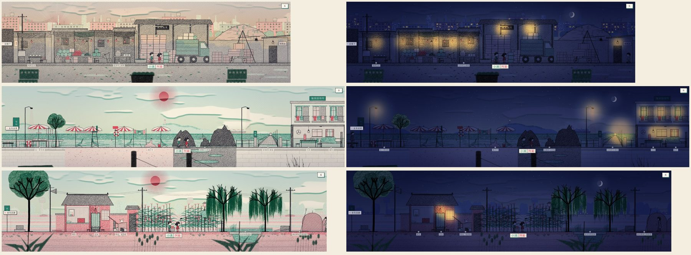

# 门外的世界：三户人家，三个夏天

> 家里有的东西能分给对门一半，但得两个人凑到一块儿。

MEANS.md 讲的是三档人家的**难度**：时间、钱、关口上的路。这一份讲的是三档人家**见到的东西**：
同样是放暑假、发烧、家里有人住院，三户人家的孩子去的地方不一样，碰上的人和场面不一样。

## 一、三张新图

| 图 | 谁去得了 | 怎么去 | 能做的事 |
| --- | --- | --- | --- |
| 早市 `market` | 清贫人家 6 岁起，别人 18 岁起 | 楼下胡同口（`to_market`，x 1390） | 喝碗豆浆、帮家里卖菜、在早市上转转、帮批发的卸菜、把攒的瓶子纸壳拿去卖、买菜（22 岁起） |
| 海边 `seaside` | 只能跟着出门（`trip`） | 夏天的事里选「去」 | 买串贝壳、下海、堆沙子、赶海、在栈桥头看船；招待所里吃饭睡觉 |
| 乡下 `village` | 只能跟着出门（`trip`） | 夏天的事里选「去」 | 喂鸡捡鸡蛋、跟着下地、在河沟里摸鱼、躺在晒场上看星星；姥姥家吃饭睡觉 |

- 清贫人家歇着的日子「帮家里看摊」，摊从周家早点铺搬到了早市上「家里的菜摊」（`veg_stall`）。清贫六户没有一户开铺子，看的是早市上的菜摊。tracks.yaml 十处 restDuty 只换了点位，钟点和数一个没动。
- 海边、乡下是 far 图：在那儿的人和河畔里的人叫不过来，影子也过不去。坐车回家要一整段。
- 第一次到一张图（被送来、走进来、在那儿做过事）打 `saw_market` / `saw_sea` / `saw_village`，一生小结读它。

## 二、夏天：三件事，一个抛一个接

童年的夏天（6~8、9~11 岁各一件），楼道里早上碰上：

| 事 | 谁家的 | 那一家能选 | 对门能选 |
| --- | --- | --- | --- |
| 旅行包 / 泳衣（`out_sea_1/2`） | 殷实 | 拉上对门一块儿去 / 跟着家里上车（goto 海边） | 回家问能不能跟去（tagAlong） |
| 两兜子东西 / 早班车（`out_village_1/2`） | 小康 | 叫上对门去乡下 / 拎上东西上车（goto 乡下） | 同上 |
| 三轮车 / 找零的毛票（`out_market_1/2`） | 清贫 | 叫上对门帮着看摊 / 爬上车斗跟着去（goto 早市） | 同上 |

谁都能选「这回不去了」「下楼送一送」。一个叫、一个跟，是**搭上了**（`content/duet.yaml`），两个人一块儿去那张图过一天；
一个去、一个等，也搭上了，带回来一样东西。两家同档（都殷实、都小康）就是共鸣：到了才发现对门家也来了。

所以殷实人家的孩子能把对门带到海边，**清贫人家的孩子也能把殷实人家的孩子带去早市**。
被带去过的那一个，一生小结里有一句（`l_took_sea`、`l_took_market`）：「后来不管住到哪儿，买菜从不跟人讲那五毛钱。」

两个人被送到同一张图上，命运会在那张图上再排一件两个人的事（招待所夜里的浪声 `pl_sea_night`、晒场上的露天电影 `pl_vil_movie`）。

## 三、发烧那天（`out_sick`，7~11 岁冬天）

| 家境 | 自己那一项 | 去哪儿 |
| --- | --- | --- |
| 郑家（大夫家，`fam_doctor`） | 妈在区医院，直接领你去 | 送到医院，不用托人、不欠人情（`tie_hospital` 不摘） |
| 殷实（没断供，不是郑家） | 爸妈托人挂了专家号 | 送到医院，精力回来得快 |
| 小康 | 一早去医院排队挂号（2 块） | 送到医院，排一上午 |
| 清贫 | 去街道卫生所打一针（1 块） | 不去医院 |
| 谁都有 | 喝碗姜汤捂一身汗 / 硬撑着去上学 | 在家 / 上学 |

医院加了挂号的点位（`hosp_queue`，排队看病）和「坐车回家」的出口（x 320 ↔ 楼下茶社门口的公交站 x 3150），小孩看完病能自己回去。

## 四、家里有人住了院

- 清贫（13~16 岁）：`out_kin_hurt`「铝饭盒」。三个选项都打 `kin_care`：上学的日子日程拖到傍晚（放了学去医院送饭），歇着的日子在医院陪床（`rules.daily.flagDuty`）。医院对带 `kin_care` 的人开着，病房的椅子上多一件「给家里人送饭」。过一阵「出院那天」摘掉，打 `kin_cared`。
- 小康：`out_kin_mid`「替半天」，礼拜天去替爸妈半天。
- 殷实：`out_kin_rich`「十分钟」，单间、护工，你在床边坐了十分钟。
- 对门：`out_kin_visit`「两份作业」，一个刚从医院回来，一个记了两份作业。

同一件事三户人家各写一份，不评价，让人在对照里看出差别。

## 五、少年、青年出远门（纯文字）

殷实：头一回坐飞机去南边（`out_plane`）、毕业那年家里出钱出去转一圈（`out_grad_trip`）。
小康：爸单位组织进山玩一天，一家能带一个孩子（`out_unit_trip`）。
清贫：暑假去批发市场扛货挣学费（`out_summer_work`）、头一回出远门，站票（`out_standing`，外地车站）。

## 六、引擎（server/src/outside.ts）

| 字段 | 写在哪 | 做什么 |
| --- | --- | --- |
| `effects.goto: 图` | 普通事件的选项（关口、主线不许） | 结算后送到那张图第一个出口跟前，手上的事撤掉，今天的日程免了（`w.off`），记 `w.trip[role]`。第二天在自己床上醒 |
| `effects.tagAlong: [选项…]` | mirror 的选项 | 对门选了列出的那一项（带 goto）就跟去同一张图，否则什么也不发生 |
| `trip: true` | 图 | 只有 goto 能来，别人看到「得跟着家里出门才来得了」；不许有出口指进来 |
| `seen: 标记` | 图 | 来过就打上 |
| `requires.either` | mirror | 两个人里至少一个人**自己**满足（不是两人合起来的标记） |
| `rules.daily.flagDuty` | rules.yaml | 带这个标记的人，上学的日子日程往后拖、歇着的日子换一段（kin_care） |

- 到了以后再排事：自己今天那一格空着、过完了、或者排在去不了的图上，七成从目的地图上的 solo 里再排一件；两个人到了同一张图，按早上的机会再排一件那儿的 mirror。主线不动。
- 影子不出门：有别的项能选时，影子不选带 goto / tagAlong 的项（不让在线的那个人对着一张空了的图）。
- `w.trip` 是 s.world 里的可选字段，存档和重连带着它，不升存档版本和协议。

## 七、怎么验

- `server/test/outside.test.mjs`：送到、第二天回家、只在被叫时跟去、trip 图走不进去、seen、either 分档、kin_care 拖日程和歇着的日子在医院、早市的门槛、看病三档选项、影子不出门、两个人同到海边会排一件海边的 mirror。
- `server/test/story.test.mjs`：选了 goto 的照 worldChoose 送过去，地点小事和两个人的事都出得来。
- means.test 第九节「三档拉开」顺序不变（二十二岁坐办公室 53 / 75 / 85，三十岁有房 18 / 40 / 90）。
- 截图：`/mnt/project-files/tongsui/art/outside/`，`tools/shots/scenes_tour.gd` 加了三张图的几行。

## 八、还没做的

- 年代变化没进底图（早市的杆秤老了换电子秤要走街景层 street.yaml）。
- 海边远景的岬角和货轮偏大偏近；医院出口的提示字压住了玻璃门上的「车站」。
