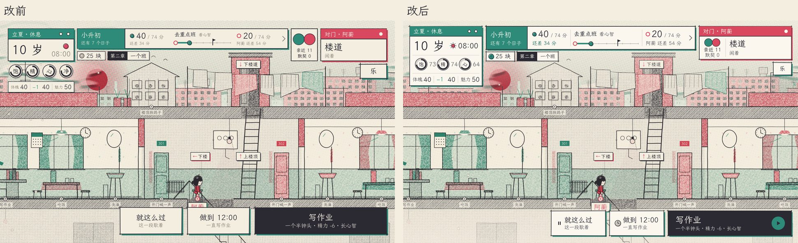
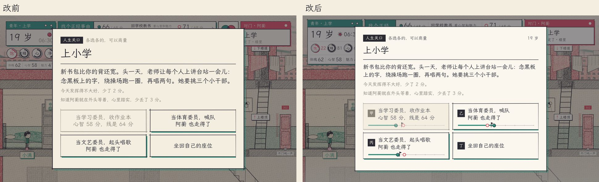
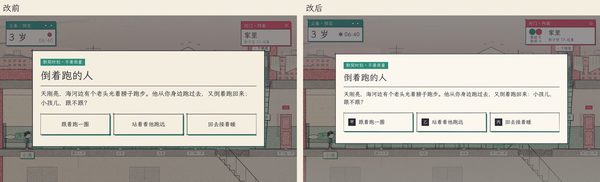
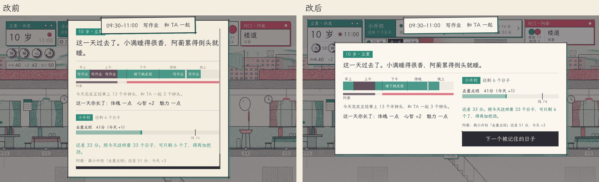

# 界面规范（11-11 重做）

还是孔版那一套：纸、墨、青、梅四色，一种框（`ui/riso_box.gd`）。这次补上的是**怎么用它们**，让每张牌、每个按钮看上去出自同一个人的手。



## 字级（`palette.gd`）

横屏设计稿高 1080，手机横拿时 1px ≈ 0.063mm。新写的界面只用这六档：

| 常量 | 字号 | 用在 |
|---|---|---|
| `FS_HERO` | 64 | 年纪、整屏大字 |
| `FS_TITLE` | 52 | 弹窗标题（事件标题用 +4） |
| `FS_H` | 40 | 小标题、按钮大字 |
| `FS_BODY` | 34 | 正文、选项票 |
| `FS_LABEL` | 28 | 标签、色条上的字 |
| `FS_CAPTION` | 24 | 说明、单位。**最小就是它**，别再写 20、22 |

## 颜色的深浅档

不加新色，只是四色的几档：`PAPER_HI`（浮在地图上的纸片，比底纸亮一档）、`INK_MID`（第二层的字，比 `INK_SOFT` 深，手机上看得清）、`HAIR`（纸片里分区的细线）、`SHADE`（不印专色时垫的影子）。

## 留白、线、动效

- 留白用 8 的倍数：`SP_XS 8 / SP_S 16 / SP_M 24 / SP_L 40 / SP_XL 64`。
- 外框 `LINE` 2.5，纸片里的分区 `LINE_HAIR` 1.5。
- 动效时长：`T_FAST 0.14`（按下、提示）、`T_BASE 0.26`（卡片落下）、`T_SLOW 0.42`（整屏）。

## 自绘控件和 StyleBox 一个画法（`kit.gd`）

HUD、纸带、成长账这些是自己 `_draw` 的。用 `Kit.draw_sheet`（错位色块 + 亮纸 + 四边出头的墨线）、`Kit.draw_band`（顶上色条）、`Kit.hair`（细分区线）、`Kit.text`（一行字，可右对齐、可限宽），画出来和 `riso_box` 的按钮放一起看不出两样。

## 图标（`icons.gd`）

一套墨线小图标，底下错开半格印一块专色：`clock coin flag sun moon play pause chevron lock check pair book bed walk star`。`Icons.draw(canvas, kind, 圆心, 半径, 专色)`；要放进容器里用 `Icons.Glyph`。

## HUD：三块纸，上沿对齐

- 左「我」的牌（`ME_W` 352）：色条（节气 · 学期，右头撕日历的两个孔）→ 年纪 + 钟点（太阳 / 月亮）→ 三个圆表（圆里是字，旁边是数）→ 成长账。一张纸，细线分三截；成长账的字是 `stat_strip.gd` 画的，框是 HUD 画的。
- 右「对门」的牌（`THEM_W` 448）：色条是 TA 的颜色；左边两个圆（亲近、默契），右边 TA 在做什么。
- 中间关口纸带夹在两块之间，底下两张小签：零花钱、主线。
- 顶上 360、底下 240 各铺一层很淡的纸色（`SCRIM_A` 0.5）往里淡掉，压住地图网点，字清楚。
- `unit_layout.gd` 看着：各种屏宽、有无刘海，三块不压、上沿对齐、纸带放得下两个人的数。

## 行动按钮、选项票、日结卡

- 行动按钮：墨底，字靠左两行，右头一颗玩家颜色的圆「按」（灰着时是停）。「就这么过」「做到点」左头各一个小图标。
- 选项票（`Kit.make_option` + `Kit.option_seal`）：亮纸细线，左头一枚甲乙丙小印，像在表上勾一格。锁住的路是排线色块、字是 `INK_MID`。
- 人生关口的路票：带分数线的路，票底下垫一把小尺（`ui/path_ruler.gd`，和 HUD 纸带同一把 `GoalPanel.draw_ruler`）：实心点是我、空心点是对门、小旗是线，够不够得着一眼看出来。数据是 WORLD 的 `goals`，关口 id 和事件 id 对得上、线 id 和路的 id 对得上才画。



- 事件、关口弹窗头一行最右边写这是哪一天（`hud.time_label`），像日记本页眉。
- 日结卡：有下一道关时用宽卡左右两栏（左：今天的时间、长了什么；右：关口、还差几分、按钮），一屏放得下不用滚。




## 截图

`tools/shots/ui.gd` 是界面相关的那几张（HUD、事件、关口、日结、提示条），比 `run.sh` 快，且关掉了开局引导免得章首卡挡住：

```
xvfb-run -a godot --path client --rendering-driver opengl3 --resolution 1920x1080 --script res://../tools/shots/ui.gd -- --out=<目录>
```

真服务器状态的 HUD 和日结卡用 `tools/shots/day.gd`（见文件头）。

## 孩子的小牌（成家和下一代，见 docs/FAMILY.md）

- WORLD 里我身上带 `kid`（`{ name, age, stats, shared }`）时，「我」的牌底下隔 16 多一张小牌（`hud.kid_rect()`，宽同 `ME_W`，高 96）：上一行名字（`FS_LABEL`）+ 几岁（`FS_CAPTION`，0 岁写「不到一岁」），细线，下一行体魄 / 心智 / 魅力（百分制往下取整，和纸带一个口径）。没孩子不画、不占地方。
- 错位色块是我的颜色；两口子共用的孩子（`shared`）色块换成两色叠印 `OVERLAP`，右头两个叠着的小圆 +「两家的」。
- 行动的 Did 带 `k`（这一回孩子长了多少）：飘「孩子 心智 +3」，飞进这张小牌；落下之前牌上的数和纸带上孩子关口的「还差几分」都不拨，落下时那一项印成我的颜色、牌子跳一下。
- 带孩子的事按钮小字写「孩子长心智」；`requires.kidAge` 不在段里的事客户端也不显示（`world_view.kid_age`）。
- 孩子的关口（事件带 `kidAge`）揭晓：一个人过时签头是「孩子的关口」，尺子上的名字写「小满 · 石头」。
- 截图：`tools/shots/family.gd`（用法同 `ui.gd`），出有孩子的 HUD、飘字飞向孩子牌、孩子关口揭晓。
